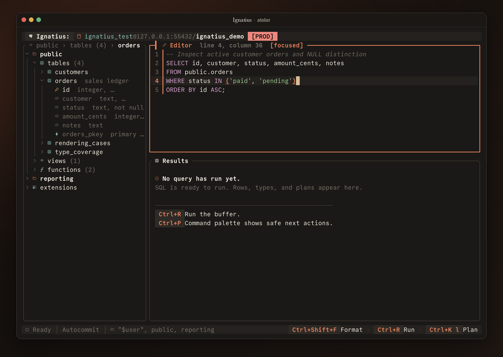
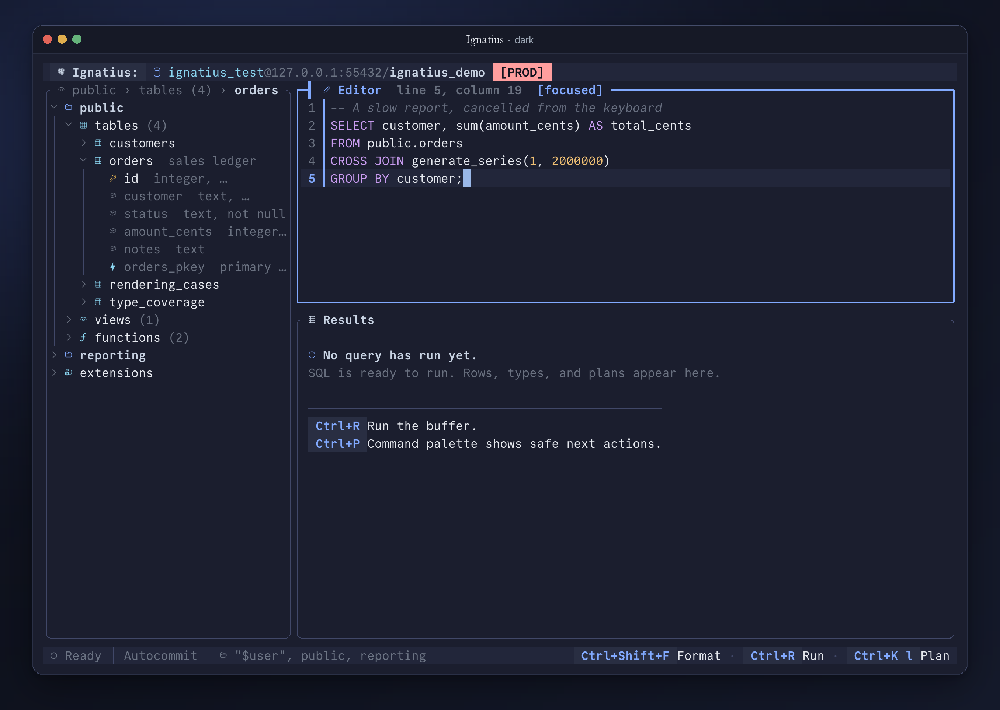
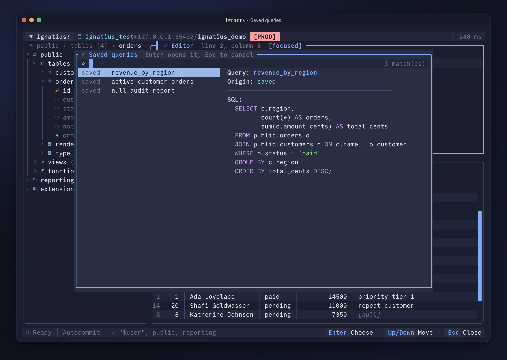
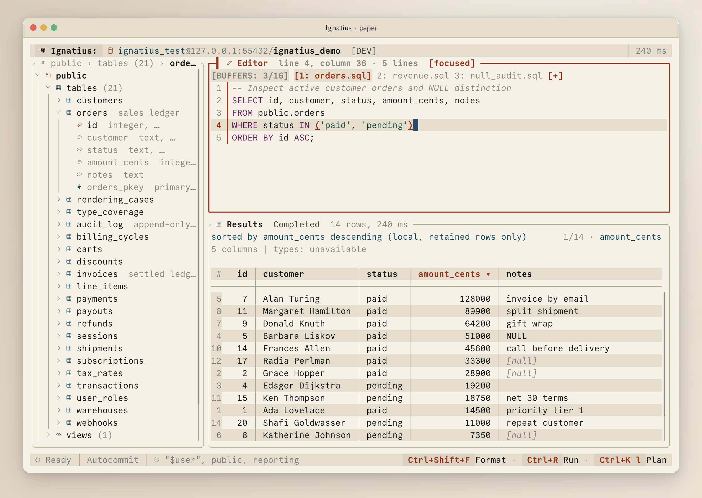
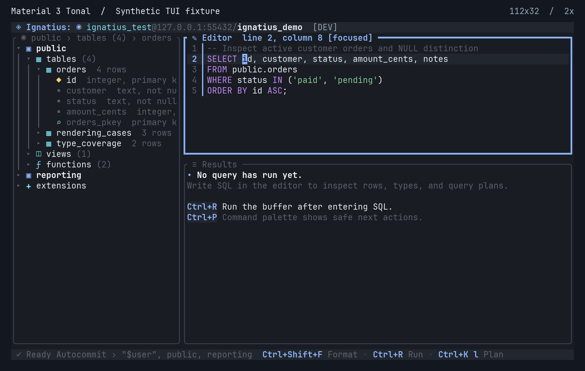

<div align="center">

<picture>
  <source media="(prefers-color-scheme: dark)" srcset="docs/assets/banner-dark.svg" />
  <source media="(prefers-color-scheme: light)" srcset="docs/assets/banner-light.svg" />
  
</picture>

<p><em>A local-first PostgreSQL workbench for the terminal, built for unhurried thinking and truthful state.</em></p>

[](https://github.com/tkomane/ignatius/actions/workflows/ci.yml)
[](docs/support/compatibility.md)
[](docs/security/data-handling.md)
[](LICENSE)

<a href="#what-it-is-like-to-use">Tour</a> &middot;
<a href="#quick-start">Quick start</a> &middot;
<a href="#everyday-keys">Keys</a> &middot;
<a href="#connecting">Connecting</a> &middot;
<a href="#scripting-and-ci">Scripting</a> &middot;
<a href="#reference">Reference</a>

<br />


</div>

Most engineers explore a schema in one tool and retreat to `psql` the moment a database becomes real. Ignatius is built to stay open for both. It pairs warm editorial typography and tonal surfaces with PostgreSQL's own semantics, telling you in plain words which role, database, and TLS posture you are holding, and saying "unknown" whenever the server withholds an answer.

Every action is driven from the keyboard, discovers itself without a manual, and runs inside a single local binary with no account, no cloud service, and no telemetry.

**Calm.** Tonal elevation across four surfaces, optional iconography, and brief motion that yields to every keystroke.<br />
**Truthful.** Transport security read back from the session, production marked as a word you declare, and uncertainty spoken aloud.<br />
**Complete.** One instrument for interactive exploration, explain-plan forensics, schema drift, and scriptable CI checks.

---

## What it is like to use

### Arrival and orientation

<p align="center">
  <picture>
    <source media="(prefers-reduced-motion: reduce)" srcset="docs/assets/motion/boot-reveal-still.png" />
    
  </picture>
</p>

Opening a connection greets you with a bounded 1.1-second sweep across the connecting handshake, settling on the wordmark and its quiet tagline before handing focus to the editor. Press any key or enable `ui.reduced-motion = true` and the final frame appears immediately.

<p align="center">
  
</p>

The top rail answers the questions you should never have to guess. Which role, host, and database. Whether you declared this target `[PROD]` or `[STAGING]`. Whether the session is `[READ ONLY]`, or whether a transaction is open (`[TX ACTIVE]`) or aborted (`[TX FAILED]`). Open **Connection and auth details** from the palette to inspect the exact TLS mode read back from PostgreSQL, so `require` and `verify-full` are never blurred together. Strip colour away or shrink the terminal, and decoration yields first while those markers remain intact as words.

### Answers, as they arrive

<p align="center">
  <picture>
    <source media="(prefers-reduced-motion: reduce)" srcset="docs/assets/motion/run-and-settle-still.png" />
    
  </picture>
</p>

While PostgreSQL works, a small comet travels back and forth along a 24-cell hairline track beside `Running` and a live tenth-of-a-second clock. Because PostgreSQL reports no completion percentage for an ordinary query, the track never pretends to fill. When rows land, `Completed` and the grid rule glow briefly and settle back to calm ink, making even an identical rerun unmistakably fresh. Inside the grid, `[null]`, an empty cell, and the literal text `NULL` stay distinct without relying on colour alone, while sorted columns display an inline chevron (`▾` / `▴`) when column width allows.

<p align="center">
  <picture>
    <source media="(prefers-reduced-motion: reduce)" srcset="docs/assets/motion/cancel-honestly-still.png" />
    
  </picture>
</p>

Press `Ctrl+C` and the heartbeat turns amber while the status reports `Cancellation requested`, because until PostgreSQL replies with SQLSTATE `57014` the statement may still be running. In-flight benchmarks cancel through the same bounded socket-EOF handoff and roll back cleanly without leaving an open transaction behind. If a connection drops mid-flight, Ignatius states `Connection lost - query outcome unknown`.

### Reading plans and catching slips

<p align="center">
  
</p>

`Ctrl+K l` inspects the planner's estimate without touching data; `Ctrl+K a` runs `EXPLAIN ANALYZE` after explicit confirmation. Each tree node displays a proportional 5-cell micro-bar alongside measured rows, loop timing, and unclipped `[attention: measured time]` and `[estimate mismatch]` badges. Because attention scores exclusive self-time rather than inclusive parent totals, the warning lands on the real bottleneck node rather than almost always on the root.

<table>
  <tr>
    <td align="center" width="50%">
      
      <br />
      <sub>Error carets align directly beneath the failing token.</sub>
    </td>
    <td align="center" width="50%">
      
      <br />
      <sub>Every generated cell edit is reviewed before it runs.</sub>
    </td>
  </tr>
</table>

Server diagnostics preserve exact whitespace so carets land squarely beneath the failing identifier, while `Ctrl+D` opens SQLSTATE and severity fields on demand. Editing a result cell synthesizes the exact bound `UPDATE` for review first, and stays disabled on production and read-only sessions. Writes from the editor against `[PROD]` pause for confirmation, destructive DDL asks you to type the database name, and `ignatius query` and `ignatius bench` refuse non-read statements on production unless `--allow-write` is supplied. Because advisory SQL classification is never a security boundary, `--read-only` enforces server-side read-only transactions in PostgreSQL itself.

### Everything a few keys away

<p align="center">
  
</p>

`Ctrl+P` opens a Spotlight-style command palette with fuzzy matching, proportional divider scroll indicators, and syntax-highlighted SQL preview cards. Saved queries, statement history, and connection profiles use the same surface. `Ctrl+K` opens a two-key chord guide listing every action available next, leaving plain letters free for SQL. When any modal opens, the panes behind it step into quiet receded ink while the header, safety capsules, and modal-scoped footer stay razor clear. There are no Vim modes to memorize, and mouse support is pure progressive enhancement.

### Seven studio palettes

<p align="center">
  <picture>
    <source media="(prefers-reduced-motion: reduce)" srcset="docs/assets/motion/theme-curtain-still.png" />
    
  </picture>
</p>

Seven curated themes, led by warm obsidian-espresso `atelier` and archival rag-paper `paper`, switch live from the palette without reconnecting, or adapt automatically at startup via `ui.theme = "auto"` (OSC 11 luminance). The theme curtain sweeps across the pane body behind a hard edge in 320 ms so no cell ever passes through low-contrast blended intermediates, while the header and footer switch atomically on frame zero. Every non-border foreground token across all seven palettes is pinned by automated tests at `>= 4.5:1` WCAG contrast (`>= 7.0:1` in `high-contrast`) across all four surfaces. Formatting changes (`Ctrl+Shift+F`) ripple quietly down the active statement gutter in 360 ms, and `ui.reduced-motion = true` stops every animation completely.

<details>
<summary>All themes</summary>

<table>
  <tr>
    <td align="center" width="50%">
      
      <br />
      <sub><code>paper</code>: warm archival rag-paper light.</sub>
    </td>
    <td align="center" width="50%">
      
      <br />
      <sub><code>material</code>: cool tonal dark.</sub>
    </td>
  </tr>
  <tr>
    <td align="center" width="50%">
      
      <br />
      <sub><code>field-industrial</code>: matte anodized slate with signal amber.</sub>
    </td>
    <td align="center" width="50%">
      
      <br />
      <sub><code>light</code>: crisp daylight.</sub>
    </td>
  </tr>
</table>

</details>

<details>
<summary>More of the workbench</summary>

<table>
  <tr>
    <td align="center" width="50%">
      
      <br />
      <sub>Schema completion, <code>Ctrl+Space</code>.</sub>
    </td>
    <td align="center" width="50%">
      
      <br />
      <sub>Saved queries with SQL card, <code>Ctrl+K o</code>.</sub>
    </td>
  </tr>
  <tr>
    <td align="center" width="50%">
      
      <br />
      <sub>Query plans: <code>Ctrl+K l</code> estimates safely, <code>Ctrl+K a</code> measures after confirmation.</sub>
    </td>
    <td align="center" width="50%">
      
      <br />
      <sub>A/B benchmarks, <code>Ctrl+K '</code>, isolated in <code>BEGIN</code>/<code>ROLLBACK</code> by default.</sub>
    </td>
  </tr>
  <tr>
    <td align="center" width="50%">
      
      <br />
      <sub>Schema snapshots and drift guard, <code>Ctrl+K &quot;</code>.</sub>
    </td>
    <td align="center" width="50%">
      
      <br />
      <sub>Interactive SQL runbooks with write-guard dry run, <code>Ctrl+K ?</code>.</sub>
    </td>
  </tr>
</table>

</details>

Every image and animation above is captured deterministically from real Ratatui widget buffers over synthetic fixtures and framed in a 2x Retina studio window. No frame is tweened.

---

## Quick start

You need a Rust toolchain (rustup selects the pinned version; the minimum is 1.90.0) and Docker for the disposable practice database. Because no public release binary has been published yet, Ignatius is built from source.

```bash
git clone https://github.com/tkomane/ignatius.git
cd ignatius
cargo xtask db up      # disposable PostgreSQL 18 on ports 55432 and 55433
cargo xtask run        # open Ignatius against the practice fixture
```

A few first moves once the workbench opens:

- Type `SELECT label, value FROM rendering_cases;` and press `Ctrl+R`. Observe `[null]`, empty text, and literal `NULL` stay distinct.
- Move the cursor onto `SELECT * FROM orders WHERE customer_id = 10482;` and press `Ctrl+K l` for an estimated plan without executing the statement; press `Esc` to return.
- Press `Tab` into Results, choose any cell with the arrow keys, and press `Enter` to open Cell Detail (`Esc` closes it).
- Press `Ctrl+P`, type `theme`, and run **Switch theme** to sweep between `atelier`, `paper`, `material`, and the rest.
- Press `Ctrl+K` alone to browse every chord, `F1` for help, and `Ctrl+Q` to quit.

When you finish, `cargo xtask db down` removes the practice containers and volumes. Synthetic fixture credentials live in `docker/dev.env` and are wired automatically by `cargo xtask run`.

To install a release build into `~/.local/bin` (or `--dir PATH`), run `cargo xtask install`, then verify and connect to your own target while supplying passwords via `.pgpass`, `PGPASSWORD`, or the masked prompt:

```bash
ignatius connect --check "postgres://app_user@db.internal:5432/analytics?sslmode=verify-full"
ignatius connect "postgres://app_user@db.internal:5432/analytics?sslmode=verify-full"
```

`--check` verifies each connection and TLS stage without entering the full-screen terminal interface.

Ignatius is built and tested across macOS, Linux, and Windows in CI. Warp on macOS and Windows Terminal on Windows 11 are first-class targets; human interactive acceptance and ADR-0008 owner signing gates remain open and are tracked honestly in [the compatibility guide](docs/support/compatibility.md). The full three-pane workspace fits 80x24 and adapts cleanly down to 40x8.

---

## Everyday keys

| Key | What it does |
| --- | --- |
| `Ctrl+R` | Run the whole buffer (`F5` also works) |
| `Ctrl+T` | Run the statement at the cursor (`F9` also works) |
| `Ctrl+C` | Cancel the running statement or benchmark |
| `Tab` | Move focus between the object tree, editor, and results |
| `Ctrl+P` | Open the command palette |
| `Ctrl+K` | Start a two-key chord and display every follow-up key |
| `Ctrl+Space` | Show schema completion |
| `Ctrl+Shift+F` | Format the SQL buffer locally |
| `F1` | Show or hide help (`Ctrl+G` where `F1` is unavailable) |
| `Ctrl+Q` | Quit |

Every action has a configurable name under `[keys]`, every chord appears in help, and the complete reference lives below in [the chord menu](#two-key-chord-menu-ctrlk) and [the keymap](docs/design/keymap.md).

---

## Connecting

### URIs and Flags

```bash
# A connection URI. Keep the password out of it.
ignatius connect "postgres://app_user@db.internal:5432/analytics?sslmode=verify-full"

# Individual flags, asking PostgreSQL to enforce a read-only session
ignatius connect --host db.internal --port 5432 --username app_user --dbname analytics --sslmode verify-full --read-only

# A named profile
ignatius connect @production-orders
```

Remote hosts default to `verify-full`. Failed TLS connections never downgrade or retry in plaintext, and unsupported options such as `sslcrl` or `channel_binding` fail explicitly rather than being silently ignored.

### Configuration Profiles (`config.toml`)

Configuration lives in `~/.config/ignatius/config.toml` on Linux and macOS, or `%APPDATA%\ignatius\config.toml` on Windows. Profiles never store passwords.

```toml
schema_version = 1

[ui]
theme = "auto"              # "dark", "light", "high-contrast", "field-industrial", "material", "atelier", "paper", "custom", or "auto" (OSC 11)
mouse = true                # enable mouse clicks, drags, and scrolling
density = "comfortable"     # "comfortable" or "compact"
reduced-motion = false      # set true to disable animations
glyphs = "nerd-font"        # "unicode", "ascii", or "nerd-font"

[profiles.local-dev]
host = "127.0.0.1"
port = 55432
dbname = "ignatius_demo"
user = "ignatius_test"
sslmode = "disable"
environment = "dev"

[profiles.staging-analytics]
host = "staging-db.internal"
port = 5432
dbname = "analytics"
user = "analyst"
sslmode = "require"
environment = "staging"

[profiles.production-orders]
host = "orders-primary.internal"
port = 5432
dbname = "orders"
user = "readonly_admin"
sslmode = "verify-full"
environment = "prod"        # triggers [PROD] header badge and write guards
read-only = true            # enforces PostgreSQL session read-only transaction mode
```

With profiles configured and no target argument passed, Ignatius opens a searchable connection picker; `Ctrl+K n` brings it back at any time. `nerd-font` icons are strictly opt-in and never guessed from terminal environment variables.

### Cloud Identity

Profiles can request short-lived tokens from your cloud CLI over TLS:

- `auth = "entra"` runs `az account get-access-token --resource-type oss-rdbms`
- `auth = "aws"` runs `aws rds generate-db-auth-token`
- `auth = "gcp"` runs `gcloud sql generate-login-token`

Token negotiation is tested end-to-end against PostgreSQL over verified TLS; live cloud-hosted provider runs await controlled accounts as recorded in [the compatibility guide](docs/support/compatibility.md#cloud-identity-providers).

### Where Passwords Come From

Resolution order: connection string, `PGPASSWORD`, `.pgpass`, then a masked prompt. Any `.pgpass` readable by group or others is refused with the exact `chmod` fix. Secrets stay in memory only while authenticating, never land in config or history, and pass through a single redaction path before anything reaches display or logs.

---

## What stays on your machine

- **Nothing leaves to third parties.** No telemetry, no update pings, no accounts, and no sync. Ignatius opens sockets only to the PostgreSQL servers you configure.
- **Result rows stay ephemeral** unless you explicitly export them.
- **History logs only SQL text, never result data**, and omits statements containing password-like tokens. Pause recording anytime with `Ctrl+K v`, skip a session with `--no-history`, or disable it with `history.enabled = false`.
- **Unsaved buffers survive crashes** in a bounded recovery journal (disabled when `--no-history` or `history.enabled = false` is set; pausing with `Ctrl+K v` leaves recovery active). Inspect, export, or discard journals from the CLI:

```bash
ignatius recovery status
ignatius recovery restore --format sql > recovered.sql
ignatius recovery discard
```

Paths, file permissions, and retention lifetimes are documented in [data handling](docs/security/data-handling.md).

---

## Scripting and CI

The same binary runs headlessly without a terminal UI. `ignatius query` reads SQL from `-c`, `-f`, or stdin and writes `table`, `csv`, `tsv`, `json`, `ndjson`, `markdown`, or `insert`:

```bash
ignatius query "$DATABASE_URL" -c "SELECT order_id, total FROM orders" --format json

# Named parameters come from environment variables, never CLI arguments
IGNATIUS_MONTH=2026-11 ignatius query "$DATABASE_URL" -f monthly.sql --param-env month=IGNATIUS_MONTH

# Stream large exports safely; interrupted writes leave a .partial file and exit 9
ignatius query "$DATABASE_URL" -c "SELECT * FROM audit_log" --format csv --output audit.csv
```

Against a production-classified target, `ignatius query` and `ignatius bench` refuse any non-read statement unless `--allow-write` is passed.

### Exit Codes

| Code | Meaning |
| --- | --- |
| `0` | Success |
| `1` | A check found a policy threshold violation (`lint --fail-on`, `snapshot check --fail-on`, `growth --fail-on`, `bench`, or `fleet` drift) |
| `2` | Usage error or guard refusal |
| `3` | Configuration error |
| `4` | Could not reach the server |
| `5` | Reached the server; credentials rejected |
| `6` | TLS failed under the requested policy |
| `7` | PostgreSQL reported an error for a statement |
| `8` | Cancelled |
| `9` | Export interrupted; a `.partial` file may remain |
| `70` | Internal error |

<details>
<summary>Every command, with an example</summary>

Descriptions match each command's `--help`.

```bash
# Setup, configuration, history and snippets
ignatius doctor
ignatius config validate
ignatius connect --check @production-orders
ignatius history list
ignatius history clear --yes
ignatius snippet list
ignatius snippet show cache-hit-ratio
ignatius completion zsh > ~/.zfunc/_ignatius

# Catalogue meta-commands such as \dt also work with -c
ignatius query "$DATABASE_URL" -c '\dt' --format json

# Lint SQL offline, apply versioned migrations, generate a data dictionary
ignatius lint migrations/ --fail-on error --format sarif --output lint.sarif
ignatius migrate status "$DATABASE_URL" --dir migrations
ignatius migrate apply "$DATABASE_URL" --dir migrations --dry-run
ignatius docs "$DATABASE_URL" --schema public --format markdown --output docs/data-dictionary.md

# Table growth, partition plans, and restore drills into a scratch database
ignatius growth "$DATABASE_URL" --top 20 --fail-on critical
ignatius partition status "$DATABASE_URL" --schema billing
ignatius partition plan "$DATABASE_URL" --table billing.invoices --period monthly --start 2026-12-01 --count 3
ignatius restore-drill "$DATABASE_URL" --backup /backups/orders.dump --dry-run

# ER diagrams, DDL, streaming COPY, pg_dump and pg_restore, schema diffs
ignatius diagram "$DATABASE_URL" --schema public --format mermaid --output schema.mmd
ignatius ddl "$DATABASE_URL" --schema public --output schema.sql
ignatius import "$DATABASE_URL" --table orders --file orders.csv --dry-run
ignatius export "$DATABASE_URL" "SELECT * FROM orders" --format csv --output orders.csv
ignatius backup "$DATABASE_URL" --output orders.dump --format custom
ignatius restore "$DATABASE_URL" --input orders.dump --dry-run
ignatius diff "$DATABASE_URL" --source-schema public --target-schema reporting

# Server activity and locks, roles and RLS, routines, LISTEN and NOTIFY, maintenance
ignatius activity "$DATABASE_URL" --locks
ignatius audit "$DATABASE_URL" --section rls --schema public
ignatius run-routine "$DATABASE_URL" process_order -a 42 --rollback true
ignatius profile-routine "$DATABASE_URL" calculate_tax --format json
ignatius listen "$DATABASE_URL" order_events --timeout 30 --format jsonl
ignatius notify "$DATABASE_URL" order_events "order 1042 placed"
ignatius maintain "$DATABASE_URL" vacuum orders --analyze

# Statement statistics, indexes and bloat, WAL and checkpoints, connection pools
ignatius profile-queries "$DATABASE_URL" --sort mean --limit 20 --format table
ignatius index-advisor "$DATABASE_URL" --format table
ignatius wal-stats "$DATABASE_URL" --format table
ignatius pool-stats "$DATABASE_URL" --format table

# Masking rules, cross-database copy, synthetic fixtures, replication and server settings
ignatius mask-rules "$DATABASE_URL" --schema public
ignatius sync --source "$STAGING_URL" --target "$DEV_URL" --dry-run
ignatius seed "$DATABASE_URL" --schema public --rows 25 --format sql
ignatius replication "$DATABASE_URL" --section all --format table
ignatius cluster "$DATABASE_URL" --section settings --modified-only --format json

# Keyset browsing, plan diffs, result analytics, benchmarks, snapshots, runbooks, fleets
ignatius browse "$DATABASE_URL" --table public.orders --page-size 50 --format table
ignatius plan-diff "$DATABASE_URL" --baseline "SELECT * FROM orders" --candidate "SELECT order_id FROM orders WHERE order_id = 1" --analyze
ignatius analytics "$DATABASE_URL" -c "SELECT * FROM orders" --format parquet -o orders.parquet
ignatius bench "$DATABASE_URL" -c "SELECT * FROM public.orders" --warmup 2 --runs 10 --format table
ignatius snapshot capture "$DATABASE_URL" --schema public -o schema.snapshot.json
ignatius snapshot check "$DATABASE_URL" --against schema.snapshot.json --schema public --fail-on breaking
ignatius runbook --file incident.md --dry-run --format table
ignatius plan-history show --series orders-plan --format json
ignatius fleet --baseline @app-dev --candidate @app-staging --schema public --format json
```

</details>

---

## Reference

### Two-Key Chord Menu (`Ctrl+K`)

Press `Ctrl+K` to open the live chord guide showing every key that can follow; press one to act, or `Esc` to step back. Chords keep ordinary letters free for writing SQL.

<details>
<summary>Every chord</summary>

| After `Ctrl+K` | Description |
| --- | --- |
| `,` | Shrink the sidebar or editor share |
| `.` | Grow the sidebar or editor share |
| `z` | Zoom the focused pane or restore the layout |
| `b` | Show or hide the object tree |
| `p` | Open the command palette |
| `c` | Copy the selected result value |
| `u` | Generate a reviewed UPDATE from the selected cell |
| `q` | Format the SQL buffer |
| `n` | Choose a connection |
| `g` | Open result grid controls |
| `[` | Narrow the selected result column by 2 cells |
| `]` | Widen the selected result column by 2 cells |
| `l` | Show the estimated query plan |
| `a` | Measure the query plan (executes the statement) |
| `f` | Filter the object tree |
| `r` | Reload the object tree |
| `h` | Show or hide help |
| `x` | Expand the selected row down the screen |
| `i` | Inspect the selected cell |
| `s` | Search the statements that have run |
| `v` | Pause or resume recording statements |
| `d` | Show the selected object's definition |
| `y` | Show what depends on the selected object |
| `w` | Save the buffer as a named query |
| `o` | Open a saved query |
| `e` | Write the rows on screen to a file |
| `m` | Open the schema ER diagram |
| `j` | Open the server activity and locks dashboard |
| `t` | Open the roles, privileges, and RLS auditor |
| `k` | Open the schema diff and migration designer |
| `<` | Open the data import wizard |
| `(` | Open the routine runner and profiler |
| `>` | Open maintenance operations and pub-sub monitor |
| `%` | Open query performance and stat forensics |
| `^` | Open index advisor and bloat forensics |
| `&` | Open transaction, WAL, and checkpointer observability |
| `*` | Open connection pool and pgbouncer telemetry |
| `)` | Open data masking and anonymization rules |
| `|` | Open cross-database copy and sync pipelines |
| `+` | Open synthetic test fixture generator |
| `=` | Create new SQL editor buffer |
| `-` | Close current SQL editor buffer |
| `}` | Switch to next SQL editor buffer |
| `{` | Switch to previous SQL editor buffer |
| `\` | Toggle editor buffer split mode |
| `;` | Open snippet and scratchpad library |
| `!` | Lint the active SQL buffer |
| `#` | Open logical replication and slots manager |
| `@` | Open server config, HBA, extensions, and FDWs |
| `:` | Stop active psql watch loop |
| `_` | Open live data browser and batch CRUD |
| `/` | Open extended EXPLAIN and A/B plan diff |
| `$` | Open result profiler and HTML/Parquet export |
| `'` | Run query latency benchmark and A/B suite |
| `"` | Inspect schema snapshot and drift guard |
| `?` | Open interactive SQL Markdown runbook |

</details>

When an unsaved crash-recovery journal is waiting at startup, `Ctrl+K r` restores the buffers and `Ctrl+K d` discards the journal.

### Mouse

Mouse capture is enabled by default. Click to focus a pane or select a cell, double-click to expand or inspect, click a column header to cycle its local sort, drag a column divider or pane split to resize, and scroll with the wheel (`Shift` scrolls results horizontally). Hold `Shift` while dragging to let your terminal select text directly. Set `ui.mouse = false` to hand every gesture back to the terminal without losing any capability.

### Capabilities

<details>
<summary>What the workbench and command line can do</summary>

Feature slugs such as `026-schema-er-diagrams` correspond to [the roadmap](docs/product/roadmap.md).

**Exploring and querying**

- Object tree across schemas, tables, views, functions, indexes, constraints, and sequences, with definitions (`Ctrl+K d`) and reverse dependencies (`Ctrl+K y`).
- Up to 16 SQL editor buffers with tab pills, vertical/horizontal split views (`Ctrl+K =`, `Ctrl+K \`), SQL-aware delimiter matching, local formatting, snippet library (`Ctrl+K ;`), saved queries (`Ctrl+K w`, `Ctrl+K o`), and bounded bracketed paste.
- Result grid with inline sort chevrons, local filtering, frozen and hidden columns (`Ctrl+K g`), expanded row inspection (`Ctrl+K x`), and structured tree inspection of JSONB, arrays, ranges, PostGIS geometry/geography, and pgvector types (`Ctrl+K i`).
- Bounded `psql` backslash commands (`\d`, `\dt`, `\conninfo`, `\x`, `\watch` with `Ctrl+K :` stop) without claiming full `psql` parity.
- Query plans, estimated (`Ctrl+K l`) or measured (`Ctrl+K a`) with exclusive self-time bottleneck micro-bars, plus extended `EXPLAIN (BUFFERS, WAL)` A/B plan comparison (`Ctrl+K /`, `ignatius plan-diff`).

**Schema and data**

- Terminal ER diagrams (`Ctrl+K m`) and deterministic Mermaid, DOT, SVG, ASCII, and Unicode exports (`ignatius diagram`). `026-schema-er-diagrams`
- Deterministic DDL for schemas and objects (`Ctrl+K d`, `ignatius ddl`), with Toggle DROP and Load in Editor inside the definition viewer. `027-deep-catalog-and-ddl-generator`
- Streaming `COPY` import and export (`Ctrl+K <`, `ignatius import`, `ignatius export`) and credential-safe `pg_dump` / `pg_restore` orchestration (`ignatius backup`, `ignatius restore`). `028-data-import-export-and-backup`
- Guided schema comparison and transactional migration scripts (`Ctrl+K k`, `ignatius diff`). `030-visual-schema-designer-and-migrations`
- Keyset-paginated data browser with reviewed multi-row CRUD (`Ctrl+K _`, `ignatius browse`), PII masking rules (`Ctrl+K )`, `ignatius mask-rules`), cross-database sync (`Ctrl+K |`, `ignatius sync`), and deterministic synthetic seeding (`Ctrl+K +`, `ignatius seed`).

**Operating a server**

- Live server activity, lock blocker chains, and health (`Ctrl+K j`, `ignatius activity`). `029-server-activity-and-locks-dashboard`
- Role inheritance, privilege ACL matrix, and row-level security auditing (`Ctrl+K t`, `ignatius audit`). `031-roles-privileges-and-rls-auditor`
- PL/pgSQL routine runner and profiler inside savepoint rollback (`Ctrl+K (`, `ignatius run-routine`, `ignatius profile-routine`). `032-plpgsql-routine-runner-and-profiler`
- Asynchronous `LISTEN`/`NOTIFY` stream monitor and guarded `VACUUM`/`ANALYZE`/`REINDEX` maintenance (`Ctrl+K >`, `ignatius listen`, `ignatius notify`, `ignatius maintain`). `033-listen-notify-and-maintenance-ops`
- Statement statistics (`Ctrl+K %`), index/bloat diagnostics (`Ctrl+K ^`), WAL and checkpoint telemetry (`Ctrl+K &`), connection pools (`Ctrl+K *`), logical replication and slots (`Ctrl+K #`), and server settings, HBA rules, extensions, and FDWs (`Ctrl+K @`).

**Automation**

- Offline SQL linter with SARIF output (`Ctrl+K !`, `ignatius lint`), checksummed migrations (`ignatius migrate`), and generated data dictionaries (`ignatius docs`).
- Retention/growth audits (`ignatius growth`), partition lifecycle planning (`ignatius partition`), and scratch-database restore drills (`ignatius restore-drill`).
- Cancellable A/B benchmarks rolled back by default (`Ctrl+K '`, `ignatius bench`), SHA-256 schema snapshots with CI drift gates (`Ctrl+K "`, `ignatius snapshot`), SQL Markdown runbooks with dry-run write guards (`Ctrl+K ?`, `ignatius runbook`), private plan history (`ignatius plan-history`), and read-only multi-profile fleet comparisons (`ignatius fleet`).

</details>

### Themes

`atelier` (warm obsidian-espresso dark), `paper` (warm archival rag-paper light), `material` (cool tonal dark), `field-industrial` (matte anodized slate), `dark` (midnight), `light` (crisp daylight), and `high-contrast` (black with 7:1+ ink). `auto` probes terminal background luminance via OSC 11, and `[theme]` lets you extend any built-in palette. All non-border tokens across all seven palettes pass `>= 4.5:1` contrast across all four surface tiers (`Surface`, `SurfacePane`, `SurfaceAlt`, `SurfaceOverlay`). At 16 colours or `NO_COLOR`, surface backgrounds stay transparent and words carry every distinction. See [theme tokens](docs/design/theme-tokens.md).

### Plain Mode

`ignatius --plain connect "$DATABASE_URL"` starts a line-oriented interactive mode with no alternate screen, colour, or box drawing, built for screen readers, `TERM=dumb`, and pipes while preserving every production safeguard and transaction cue.

---

## Documentation

- [Product vision](docs/product/vision.md): the problem, principles, and explicit non-goals
- [Compatibility](docs/support/compatibility.md): supported PostgreSQL versions, terminals, platforms, and open acceptance boundaries
- [Keymap](docs/design/keymap.md): every binding, chord, and mouse gesture
- [Diagnostics](docs/support/diagnostics.md): reading server errors and exit codes
- [Data handling](docs/security/data-handling.md) and [threat model](docs/security/threat-model.md): local persistence, privacy, and secret boundaries
- [Icons and motion](docs/design/icons-and-motion.md) and [theme tokens](docs/design/theme-tokens.md): visual hierarchy, contrast guarantees, and truthful motion grammar
- [Local development](docs/operations/local-development.md) and [verification](docs/operations/verification.md): the practice database, `cargo xtask verify`, and `cargo xtask security`
- [Release operations](docs/operations/release.md): release checklist and open ADR-0008 owner gates
- [Status](docs/status.md): current wave ledger and unverified gates
- [Contributing](CONTRIBUTING.md) and [security policy](SECURITY.md)

## License

Apache-2.0. See [LICENSE](LICENSE).
