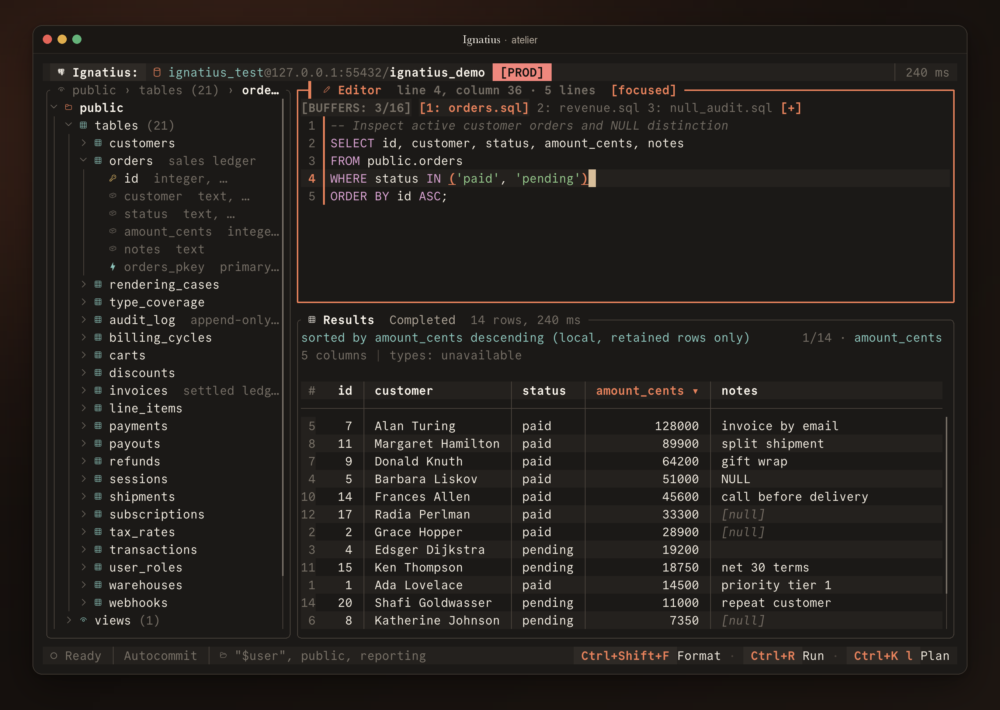
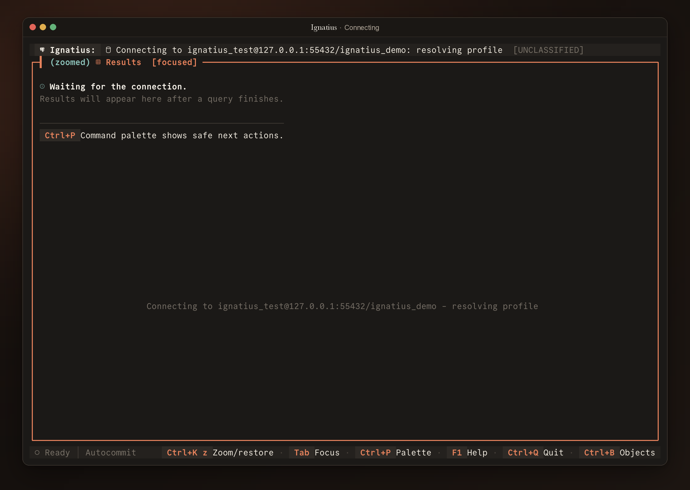
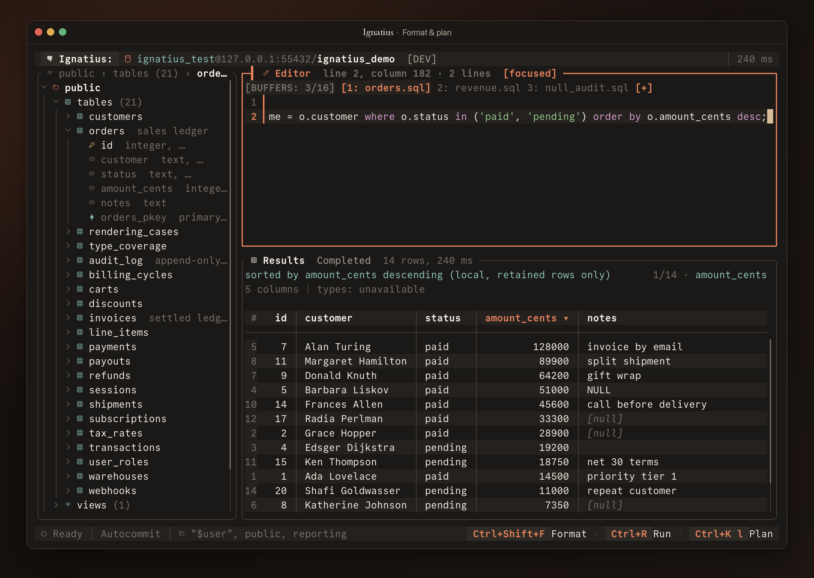
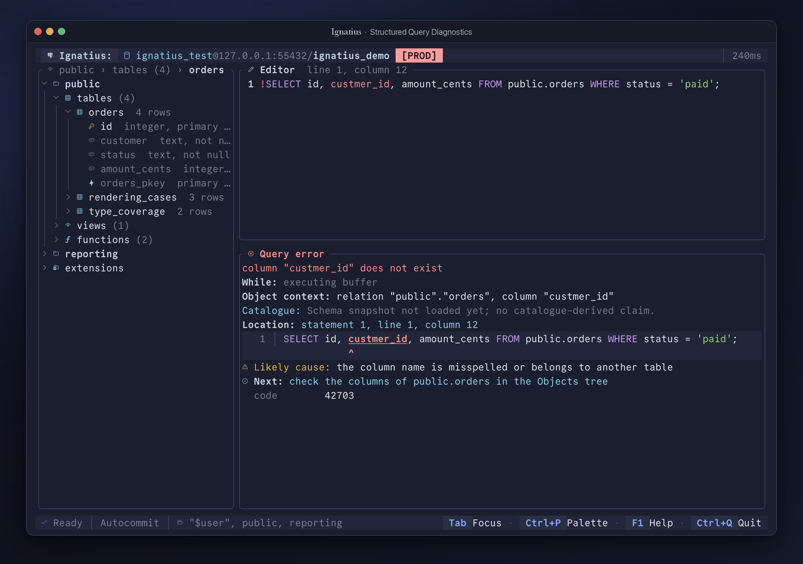
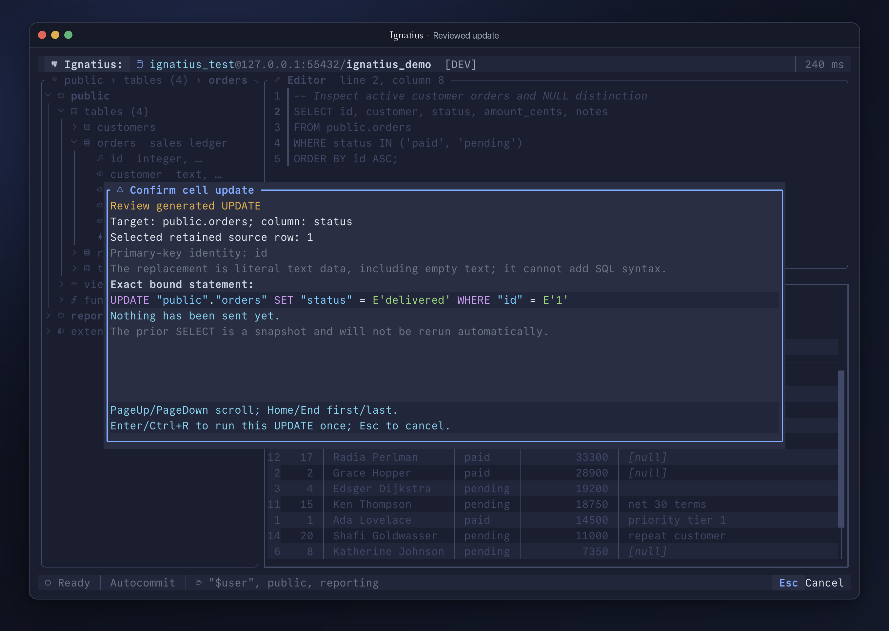
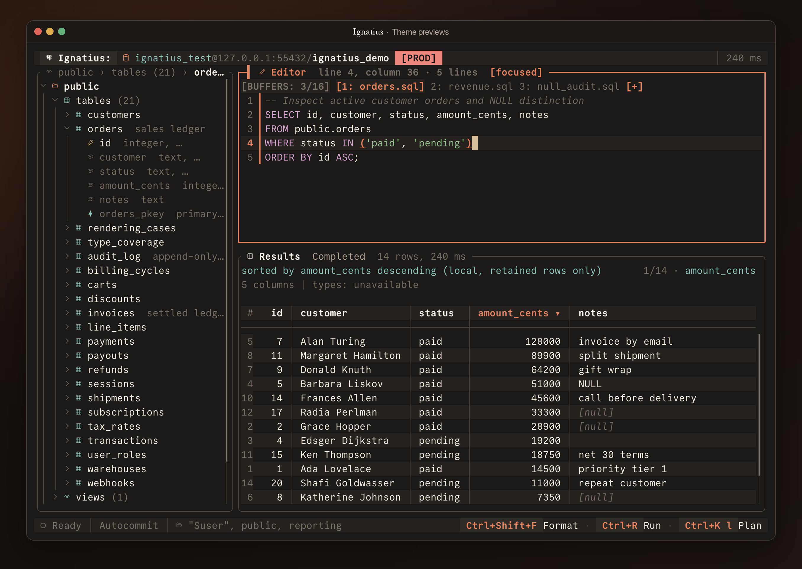
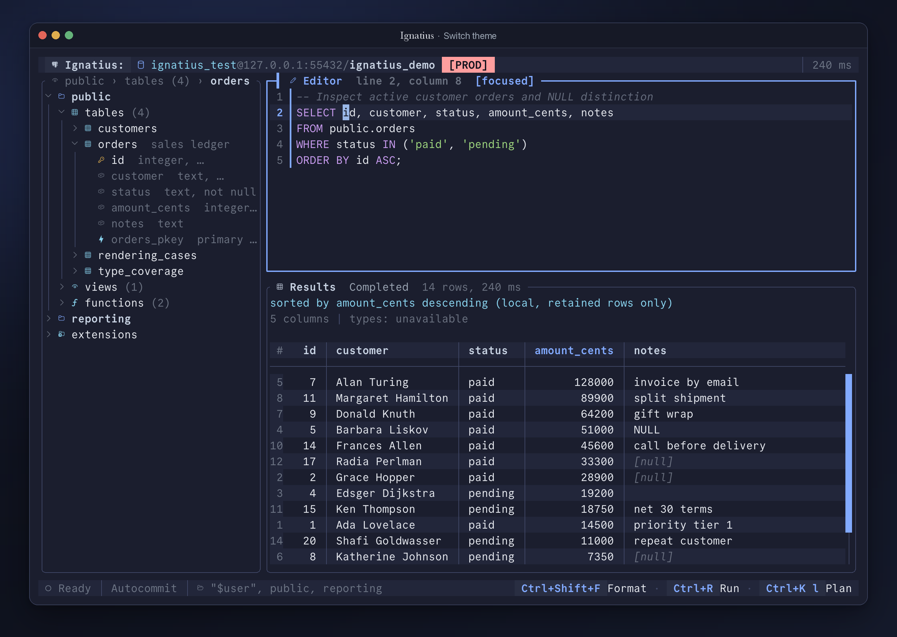
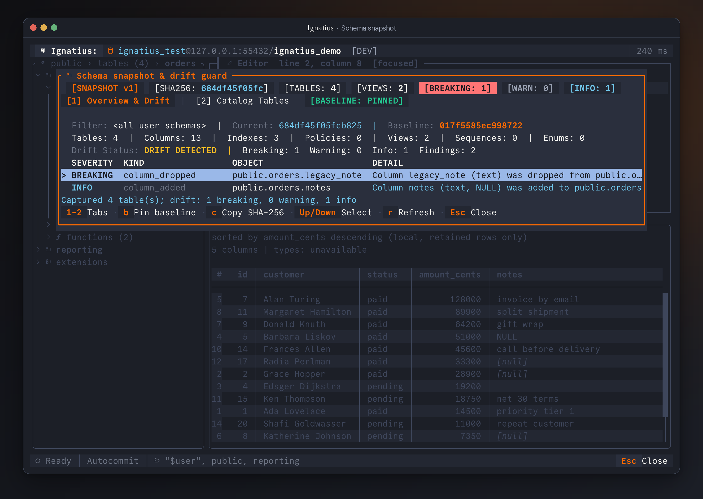

<div align="center">

<picture>
  <source media="(prefers-color-scheme: dark)" srcset="docs/assets/banner-dark.svg" />
  <source media="(prefers-color-scheme: light)" srcset="docs/assets/banner-light.svg" />
  
</picture>

<p><em>A fast, full-powered PostgreSQL workbench for your terminal.</em></p>

[](https://github.com/tkomane/ignatius/actions/workflows/ci.yml)
[](docs/support/compatibility.md)
[](docs/security/data-handling.md)
[](LICENSE)

<a href="#workbench-tour">Tour</a> &middot;
<a href="#quick-start">Quick start</a> &middot;
<a href="#everyday-keys">Keys</a> &middot;
<a href="#connecting">Connecting</a> &middot;
<a href="#scripting-and-ci">Scripting</a> &middot;
<a href="#reference">Reference</a>

<br />



</div>

Ignatius brings full PostgreSQL IDE power straight to your terminal in one fast, local Rust binary. Write SQL across up to 16 split tabs, browse schemas with live fuzzy filtering, inspect structured JSONB and array cells, profile `EXPLAIN ANALYZE` bottlenecks, run rollback-safe A/B benchmarks, generate ER diagrams and schema diffs, monitor live server locks, and stream `COPY` imports or CI checks from the exact same engine.

No Electron bloat, no account, no cloud sync, and zero telemetry. Everything is keyboard-first with optional mouse support, works over SSH or locally, and includes clear built-in guardrails (`[PROD]` badges, `--read-only` server transactions, and reviewed confirmations) whenever you need them.

**Fast.** Instant startup, responsive async execution, and bounded transitions that yield immediately to every keystroke.<br />
**Deep.** Multi-tab SQL studio, schema-aware autocomplete, plan forensics, A/B benchmarks, ER diagrams, diffs, and live locks in one workspace.<br />
**Scriptable.** Interactive TUI and headless CLI subcommands sharing one PostgreSQL engine, configuration, and exit-code contract.

---

## Workbench tour

### Fast startup and clear session posture

<p align="center">
  <picture>
    <source media="(prefers-reduced-motion: reduce)" srcset="docs/assets/motion/boot-reveal-still.png" />
    
  </picture>
</p>

Connecting opens with a crisp 1.1-second wordmark reveal across the handshake stages before handing focus straight to the SQL editor. Any keypress skips straight in, and `ui.reduced-motion = true` jumps immediately to the resting frame.

<p align="center">
  
</p>

The top rail keeps your active role, host, database, `[PROD]` / `[STAGING]` environment label, `[READ ONLY]` mode, and `[TX ACTIVE]` / `[TX FAILED]` state visible at a glance. Open **Connection and auth details** from the command palette to inspect the exact TLS mode (`require` vs `verify-full`) and cipher reported by PostgreSQL. The editor title tracks cursor position, buffer line count (`line X, column Y · N lines`), `[modified]` state, and `[focused]` status, while the object tree and result grid add hairline scrollbars (`┃`/`│`) whenever rows overflow.

### Live query execution and grid exploration

<p align="center">
  <picture>
    <source media="(prefers-reduced-motion: reduce)" srcset="docs/assets/motion/run-and-settle-still.png" />
    
  </picture>
</p>

While a query runs, a 5-cell phosphor comet glides back and forth beside `Running` and a live tenth-of-a-second clock. When rows land, `Completed`, the header rule, and the row-number gutter flash green and settle back cleanly, alongside a right-aligned `row/total · column` coordinate readout in the toolbar. Inside the grid, `[null]`, empty strings, and literal `NULL` stay visually distinct even without colour, locally sorted columns show an inline chevron (`▾` / `▴`), a 1-line column quick-stats bar summarizes row/non-NULL/NULL/distinct counts and finite numeric `min`/`max`/`sum`/`avg` (`toggle-column-stats` or `Ctrl+K g`), and query-ready copy builders turn cells or rows into escaped `WHERE` / `IN (...)` editor snippets (`insert-where-clause`, `insert-in-list`) or opt-in OSC 52 row JSON (`copy-row-json`).

<p align="center">
  <picture>
    <source media="(prefers-reduced-motion: reduce)" srcset="docs/assets/motion/cancel-honestly-still.png" />
    
  </picture>
</p>

Press `Ctrl+C` at any time to send a PostgreSQL cancel request; the comet turns amber (`Cancellation requested`) until the server confirms with SQLSTATE `57014`. In-flight A/B benchmarks cancel cleanly through the same bounded socket-EOF handoff and roll back without leaving an open transaction behind.

### Formatting, EXPLAIN ANALYZE forensics, and A/B benchmarks

<p align="center">
  <picture>
    <source media="(prefers-reduced-motion: reduce)" srcset="docs/assets/motion/format-and-plan-still.png" />
    
  </picture>
</p>

Press `Ctrl+Shift+F` to format your SQL locally with a crisp green wave down the editor statement gutter, toggle `--` line comments (`Ctrl+/`), duplicate (`Ctrl+Shift+D`) or reorder (`Alt+Up`/`Alt+Down`) lines, jump to a line (`Ctrl+L`), or search and replace across the active buffer with bounded UTF-8-safe literal Find & Replace (`Ctrl+F` / `Ctrl+H`, `F3` / `Shift+F3`, atomic single-undo Replace All). Press `Ctrl+K l` for a safe estimated plan or `Ctrl+K a` for `EXPLAIN ANALYZE`: the plan explorer surfaces a KPI strip (`Nodes`, `Planning`, `Execution`, `Hotspot`), sweeps 5-cell proportional micro-bars across each node, scores exclusive self-time/self-cost so attention flags the actual bottleneck node rather than the root, and highlights `[estimate mismatch]` rows cleanly.

<p align="center">
  
</p>

<table>
  <tr>
    <td align="center" width="50%">
      
      <br />
      <sub>Error carets align squarely beneath the failing SQL token.</sub>
    </td>
    <td align="center" width="50%">
      
      <br />
      <sub>Inline cell edits build a reviewed parameterized UPDATE first.</sub>
    </td>
  </tr>
</table>

PostgreSQL diagnostics preserve exact SQL whitespace so error carets line up under the offending token, with `Ctrl+D` toggling full SQLSTATE and severity details. Practical built-in guardrails keep mistakes cheap: inline result-cell edits preview the exact parameterized `UPDATE` and verify the observed cell value has not changed concurrently before writing (reporting 0-row conflicts without retrying), writes against `[PROD]` pause for confirmation, destructive DDL asks for the database name, `ignatius query` and `ignatius bench` require `--allow-write` for non-read statements on production targets, and `--read-only` enforces server-side read-only transactions.

### Spotlight command palette, chords, and floating overlays

<p align="center">
  
</p>

Press `Ctrl+P` for the Spotlight command palette with fuzzy match highlighting, proportional divider scrollbars, and live SQL preview cards across commands, saved query collections (`collection/name`, `-- @tag:`, `-- @description:`), statement history, and connection profiles. Press `Ctrl+K` to open the adaptive 1/2/3-column chord guide for all 58 workbench tools, leaving ordinary keys free for writing SQL. Floating modals cast a crisp 1-cell architectural drop shadow over the receded workspace while keeping the header and modal-scoped footer razor sharp. Mouse gestures work out of the box and can be turned off without losing any feature.

### Live theme previews and seven adaptive palettes

<p align="center">
  <picture>
    <source media="(prefers-reduced-motion: reduce)" srcset="docs/assets/motion/palette-themes-still.png" />
    
  </picture>
</p>

Browse `Theme: ...` entries right inside the `Ctrl+P` palette to inspect a live mini-workbench preview (header, syntax-highlighted SQL, sample grid rows, and semantic swatches) before switching. Confirming a theme sweeps a crisp truecolour `ThemeCurtain` across the pane body with a luminous `Token::Focus` leading seam while switching the header and footer atomically on frame zero.

<p align="center">
  <picture>
    <source media="(prefers-reduced-motion: reduce)" srcset="docs/assets/motion/theme-curtain-still.png" />
    
  </picture>
</p>

Seven curated built-in palettes (`atelier`, `paper`, `material`, `field-industrial`, `dark`, `light`, and `high-contrast`) ship out of the box, or `ui.theme = "auto"` can match your terminal background via OSC 11. Every non-border foreground token across all seven palettes is pinned by automated tests at `>= 4.5:1` WCAG contrast (`>= 7.0:1` in `high-contrast`) across all four elevation surfaces.

<details>
<summary>All themes</summary>

<table>
  <tr>
    <td align="center" width="50%">
      
      <br />
      <sub><code>paper</code>: warm archival rag-paper light.</sub>
    </td>
    <td align="center" width="50%">
      
      <br />
      <sub><code>material</code>: cool tonal dark.</sub>
    </td>
  </tr>
  <tr>
    <td align="center" width="50%">
      
      <br />
      <sub><code>field-industrial</code>: matte anodized slate with signal amber.</sub>
    </td>
    <td align="center" width="50%">
      
      <br />
      <sub><code>light</code>: crisp daylight.</sub>
    </td>
  </tr>
</table>

</details>

<details>
<summary>More of the workbench</summary>

<table>
  <tr>
    <td align="center" width="50%">
      
      <br />
      <sub>Schema completion, <code>Ctrl+Space</code>.</sub>
    </td>
    <td align="center" width="50%">
      
      <br />
      <sub>Saved queries with SQL card, <code>Ctrl+K o</code>.</sub>
    </td>
  </tr>
  <tr>
    <td align="center" width="50%">
      
      <br />
      <sub>Query plans: <code>Ctrl+K l</code> estimates safely, <code>Ctrl+K a</code> measures after confirmation.</sub>
    </td>
    <td align="center" width="50%">
      
      <br />
      <sub>A/B benchmarks, <code>Ctrl+K '</code>, isolated in <code>BEGIN</code>/<code>ROLLBACK</code> by default.</sub>
    </td>
  </tr>
  <tr>
    <td align="center" width="50%">
      
      <br />
      <sub>Schema snapshots and drift guard, <code>Ctrl+K &quot;</code>.</sub>
    </td>
    <td align="center" width="50%">
      
      <br />
      <sub>Interactive SQL runbooks with write-guard dry run, <code>Ctrl+K ?</code>.</sub>
    </td>
  </tr>
</table>

</details>

Every image and animation above is captured deterministically from real Ratatui widget buffers over synthetic fixtures and framed in a 2x Retina studio window.

---

## Quick start

You need a Rust toolchain (rustup selects the pinned version; the minimum is 1.90.0) and Docker for the disposable practice database. Because no public release binary has been published yet, Ignatius is built from source.

```bash
git clone https://github.com/tkomane/ignatius.git
cd ignatius
cargo xtask db up      # disposable PostgreSQL 18 on ports 55432 and 55433
cargo xtask run        # open Ignatius against the practice fixture
```

Try these right after the workbench opens:

- Type `SELECT label, value FROM rendering_cases;` and press `Ctrl+R` to see `[null]`, empty text, and literal `NULL` side by side.
- Place your cursor on `SELECT * FROM orders WHERE customer_id = 10482;` and press `Ctrl+K l` for an estimated query plan (`Esc` closes).
- Press `Tab` into Results, pick a cell with the arrow keys, and press `Enter` to open the structured Cell Detail inspector.
- Press `Ctrl+P`, type `Theme:`, and arrow through `atelier`, `paper`, `material`, and `field-industrial` to preview them live before pressing `Enter`.
- Press `Ctrl+K` to browse all 58 chords, `F1` for help, and `Ctrl+Q` to quit.

When you finish, `cargo xtask db down` removes the practice containers and volumes. Synthetic fixture credentials live in `docker/dev.env` and are wired automatically by `cargo xtask run`.

To install a release build into `~/.local/bin` (or `--dir PATH`), run `cargo xtask install`, then check and connect to any PostgreSQL instance using `.pgpass`, `PGPASSWORD`, or the masked prompt:

```bash
ignatius connect --check "postgres://app_user@db.internal:5432/analytics?sslmode=verify-full"
ignatius connect "postgres://app_user@db.internal:5432/analytics?sslmode=verify-full"
```

`--check` verifies reachability, authentication, and TLS stage without launching the full-screen TUI.

Ignatius is built and tested across macOS, Linux, and Windows in CI. Warp on macOS and Windows Terminal on Windows 11 are first-class targets; human interactive acceptance and ADR-0008 owner signing gates remain open and are tracked in [the compatibility guide](docs/support/compatibility.md). The full three-pane workspace fits 80x24 and adapts cleanly down to 40x8.

---

## Everyday keys

| Key | What it does |
| --- | --- |
| `Ctrl+R` | Run the whole buffer (`F5` also works) |
| `Ctrl+T` | Run the statement at the cursor (`F9` also works) |
| `Ctrl+C` | Cancel the running statement or benchmark |
| `Tab` | Move focus between the object tree, editor, and results |
| `Ctrl+P` | Open the command palette |
| `Ctrl+K` | Start a two-key chord and display every follow-up key |
| `Ctrl+Space` | Show schema completion |
| `Ctrl+Shift+F` | Format the SQL buffer locally |
| `F1` | Show or hide help (`Ctrl+G` where `F1` is unavailable) |
| `Ctrl+Q` | Quit |

Every action has a configurable name under `[keys]`, every chord appears in help, and the complete reference lives below in [the chord menu](#two-key-chord-menu-ctrlk) and [the keymap](docs/design/keymap.md).

---

## Connecting

### URIs and Flags

```bash
# A connection URI. Keep the password out of it.
ignatius connect "postgres://app_user@db.internal:5432/analytics?sslmode=verify-full"

# Multi-host failover with bounded statement, lock, and idle-in-transaction timeouts and search_path
ignatius connect --host primary.internal,standby.internal --port 5432 --username app_user --dbname analytics --target-session-attrs read-write --statement-timeout 30s --lock-timeout 500ms --idle-in-transaction-session-timeout 60s --search-path analytics,public

# Individual flags, asking PostgreSQL to enforce a read-only primary or standby session
ignatius connect --host db.internal --port 5432 --username app_user --dbname analytics --sslmode verify-full --read-only --target-session-attrs read-only

# A named profile
ignatius connect @production-orders
```

Multi-host lists (`host1,host2`, up to 16 endpoints) fail over sequentially alongside `target_session_attrs` (`any`, `read-write`, `read-only`, `primary`, `standby`), defaulting to `verify-full` whenever any candidate host is non-local, re-consulting `.pgpass` per endpoint, never downgrading TLS, and never retrying once a session succeeds. `--statement-timeout`, `--lock-timeout`, and `--idle-in-transaction-session-timeout` (or profile timeout settings up to 24h) enforce session timeouts at startup alongside `--search-path` (`SET search_path TO ...` using `quote_identifier`), while unsupported options such as `sslcrl` or `channel_binding` fail explicitly rather than being silently ignored.

### Configuration Profiles (`config.toml`)

Configuration lives in `~/.config/ignatius/config.toml` on Linux and macOS, or `%APPDATA%\ignatius\config.toml` on Windows. Profiles never store passwords.

```toml
schema_version = 1

[ui]
theme = "auto"              # "dark", "light", "high-contrast", "field-industrial", "material", "atelier", "paper", "custom", or "auto" (OSC 11)
mouse = true                # enable mouse clicks, drags, and scrolling
density = "comfortable"     # "comfortable" or "compact"
reduced-motion = false      # set true to disable animations
glyphs = "nerd-font"        # "unicode", "ascii", or "nerd-font"

[profiles.local-dev]
host = "127.0.0.1"
port = 55432
dbname = "ignatius_demo"
user = "ignatius_test"
sslmode = "disable"
environment = "dev"

[profiles.staging-analytics]
host = "staging-db.internal"
port = 5432
dbname = "analytics"
user = "analyst"
sslmode = "require"
environment = "staging"

[profiles.production-orders]
host = "orders-primary.internal"
port = 5432
dbname = "orders"
user = "readonly_admin"
sslmode = "verify-full"
environment = "prod"        # triggers [PROD] header badge and write guards
read-only = true            # enforces PostgreSQL session read-only transaction mode
```

With profiles configured and no target argument passed, Ignatius opens a searchable connection picker; `Ctrl+K n` brings it back at any time. `nerd-font` icons are strictly opt-in and never guessed from terminal environment variables.

### Cloud Identity

Profiles can request short-lived tokens from your cloud CLI over TLS:

- `auth = "entra"` runs `az account get-access-token --resource-type oss-rdbms`
- `auth = "aws"` runs `aws rds generate-db-auth-token`
- `auth = "gcp"` runs `gcloud sql generate-login-token`

Token negotiation is tested end-to-end against PostgreSQL over verified TLS; live cloud-hosted provider runs await controlled accounts as recorded in [the compatibility guide](docs/support/compatibility.md#cloud-identity-providers).

### Where Passwords Come From

Resolution order: connection string, `PGPASSWORD`, `.pgpass`, then a masked prompt. Any `.pgpass` readable by group or others is refused with the exact `chmod` fix. Secrets stay in memory only while authenticating, never land in config or history, and pass through a single redaction path before anything reaches display or logs.

---

## Local-first privacy

- **Zero third-party network calls.** No telemetry, no update pings, no accounts, and no sync. Ignatius connects only to the PostgreSQL servers you specify.
- **Result rows stay ephemeral** unless you explicitly export them.
- **History logs only SQL text, never result data**, and omits statements containing password-like tokens. Pause recording anytime with `Ctrl+K v`, skip a session with `--no-history`, or disable it with `history.enabled = false`.
- **Unsaved buffers survive crashes** in a bounded recovery journal (disabled when `--no-history` or `history.enabled = false` is set; pausing with `Ctrl+K v` leaves recovery active). Inspect, export, or discard journals from the CLI:

```bash
ignatius recovery status
ignatius recovery restore --format sql > recovered.sql
ignatius recovery discard
```

In the workbench, `Ctrl+K r` restores the active draft and omits empty scratch
tabs. If the active scratch tab was omitted, recovery selects the next retained
tab or falls back to the last retained tab. Clearing a file-backed tab is a
recoverable edit. `ignatius recovery restore --format json` preserves its
exact text and file association. If you clear a file-backed draft while a
recovery decision is pending, the restored workspace keeps the draft beside
the recovered tabs. If they exceed 16 tabs together, both the current
workspace and the journal stay available.

Paths, file permissions, and retention lifetimes are documented in [data handling](docs/security/data-handling.md).

---

## Scripting and CI

The same binary runs headlessly without a terminal UI. `ignatius query` reads SQL from `-c`, `-f`, or stdin and writes `table`, `csv`, `tsv`, `json`, `ndjson`, `markdown`, or `insert`:

```bash
ignatius query "$DATABASE_URL" -c "SELECT order_id, total FROM orders" --format json

# Named parameters come from environment variables, never CLI arguments
IGNATIUS_MONTH=2026-11 ignatius query "$DATABASE_URL" -f monthly.sql --param-env month=IGNATIUS_MONTH

# Stream large exports safely; interrupted writes leave a .partial file and exit 9
ignatius query "$DATABASE_URL" -c "SELECT * FROM audit_log" --format csv --output audit.csv
```

Against a production-classified target, `ignatius query` and `ignatius bench` refuse any non-read statement unless `--allow-write` is passed.

### Exit Codes

| Code | Meaning |
| --- | --- |
| `0` | Success |
| `1` | A check found a policy threshold violation (`lint --fail-on`, `snapshot check --fail-on`, `growth --fail-on`, `bench`, or `fleet` drift) |
| `2` | Usage error or guard refusal |
| `3` | Configuration error |
| `4` | Could not reach the server |
| `5` | Reached the server; credentials rejected |
| `6` | TLS failed under the requested policy |
| `7` | PostgreSQL reported an error for a statement |
| `8` | Cancelled |
| `9` | Export interrupted; a `.partial` file may remain |
| `70` | Internal error |

<details>
<summary>Every command, with an example</summary>

Descriptions match each command's `--help`.

```bash
# Setup, configuration, history, snippets, saved queries, and offline result diffs
ignatius doctor
ignatius config validate
ignatius connect --check @production-orders
ignatius history list
ignatius history search "invoices" --database billing --status failed --since 2026-10-01
ignatius history stats --json
ignatius history export --format csv --output history.csv
ignatius history clear --yes
ignatius snippet list
ignatius snippet show cache-hit-ratio
ignatius queries list --collection billing --tag finance
ignatius queries show billing/monthly-revenue
ignatius result-diff baseline.json current.json --key order_id
ignatius completion zsh > ~/.zfunc/_ignatius

# Catalogue meta-commands such as \dt also work with -c
ignatius query "$DATABASE_URL" -c '\dt' --format json

# Lint SQL offline, apply versioned migrations, generate a data dictionary
ignatius lint migrations/ --fail-on error --format sarif --output lint.sarif
ignatius migrate status "$DATABASE_URL" --dir migrations
ignatius migrate apply "$DATABASE_URL" --dir migrations --dry-run
ignatius docs "$DATABASE_URL" --schema public --format markdown --output docs/data-dictionary.md

# Table growth, partition plans, and restore drills into a scratch database
ignatius growth "$DATABASE_URL" --top 20 --fail-on critical
ignatius partition status "$DATABASE_URL" --schema billing
ignatius partition plan "$DATABASE_URL" --table billing.invoices --period monthly --start 2026-12-01 --count 3
ignatius restore-drill "$DATABASE_URL" --backup /backups/orders.dump --dry-run

# ER diagrams, DDL, streaming COPY, pg_dump and pg_restore, schema diffs
ignatius diagram "$DATABASE_URL" --schema public --format mermaid --output schema.mmd
ignatius ddl "$DATABASE_URL" --schema public --output schema.sql
ignatius import "$DATABASE_URL" --table orders --file orders.csv --dry-run
ignatius export "$DATABASE_URL" "SELECT * FROM orders" --format csv --output orders.csv
ignatius backup "$DATABASE_URL" --output orders.dump --format custom
ignatius restore "$DATABASE_URL" --input orders.dump --dry-run
ignatius diff "$DATABASE_URL" --source-schema public --target-schema reporting

# Server activity and locks, roles and RLS, routines, LISTEN and NOTIFY, maintenance
ignatius activity "$DATABASE_URL" --locks
ignatius audit "$DATABASE_URL" --section rls --schema public
ignatius run-routine "$DATABASE_URL" process_order -a 42 --rollback true
ignatius profile-routine "$DATABASE_URL" calculate_tax --format json
ignatius listen "$DATABASE_URL" order_events --timeout 30 --format jsonl
ignatius notify "$DATABASE_URL" order_events "order 1042 placed"
ignatius maintain "$DATABASE_URL" vacuum orders --analyze

# Statement statistics, indexes and bloat, WAL and checkpoints, connection pools
ignatius profile-queries "$DATABASE_URL" --sort mean --limit 20 --format table
ignatius index-advisor "$DATABASE_URL" --format table
ignatius wal-stats "$DATABASE_URL" --format table
ignatius pool-stats "$DATABASE_URL" --format table

# Masking rules, cross-database copy, synthetic fixtures, replication and server settings
ignatius mask-rules "$DATABASE_URL" --schema public
ignatius sync --source "$STAGING_URL" --target "$DEV_URL" --dry-run
ignatius seed "$DATABASE_URL" --schema public --rows 25 --format sql
ignatius replication "$DATABASE_URL" --section all --format table
ignatius cluster "$DATABASE_URL" --section settings --modified-only --format json

# Keyset browsing, plan diffs, result analytics, benchmarks, snapshots, runbooks, fleets
ignatius browse "$DATABASE_URL" --table public.orders --page-size 50 --format table
ignatius plan-diff "$DATABASE_URL" --baseline "SELECT * FROM orders" --candidate "SELECT order_id FROM orders WHERE order_id = 1" --analyze
ignatius analytics "$DATABASE_URL" -c "SELECT * FROM orders" --format parquet -o orders.parquet
ignatius bench "$DATABASE_URL" -c "SELECT * FROM public.orders" --warmup 2 --runs 10 --format table
ignatius snapshot capture "$DATABASE_URL" --schema public -o schema.snapshot.json
ignatius snapshot check "$DATABASE_URL" --against schema.snapshot.json --schema public --fail-on breaking
ignatius runbook --file incident.md --dry-run --format table
ignatius plan-history show --series orders-plan --format json
ignatius fleet --baseline @app-dev --candidate @app-staging --schema public --format json
```

</details>

---

## Reference

### Two-Key Chord Menu (`Ctrl+K`)

Press `Ctrl+K` to open the live chord guide showing every key that can follow; press one to act, or `Esc` to step back. Chords keep ordinary letters free for writing SQL.

<details>
<summary>Every chord</summary>

| After `Ctrl+K` | Description |
| --- | --- |
| `,` | Shrink the sidebar or editor share |
| `.` | Grow the sidebar or editor share |
| `z` | Zoom the focused pane or restore the layout |
| `b` | Show or hide the object tree |
| `p` | Open the command palette |
| `c` | Copy the selected result value |
| `u` | Generate a reviewed UPDATE from the selected cell |
| `q` | Format the SQL buffer |
| `n` | Choose a connection |
| `g` | Open result grid controls |
| `[` | Narrow the selected result column by 2 cells |
| `]` | Widen the selected result column by 2 cells |
| `l` | Show the estimated query plan |
| `a` | Measure the query plan (executes the statement) |
| `f` | Filter the object tree |
| `r` | Reload the object tree |
| `h` | Show or hide help |
| `x` | Expand the selected row down the screen |
| `i` | Inspect the selected cell |
| `s` | Search the statements that have run |
| `v` | Pause or resume recording statements |
| `d` | Show the selected object's definition |
| `y` | Show what depends on the selected object |
| `w` | Save the buffer as a named query |
| `o` | Open a saved query |
| `e` | Write the rows on screen to a file |
| `m` | Open the schema ER diagram |
| `j` | Open the server activity and locks dashboard |
| `t` | Open the roles, privileges, and RLS auditor |
| `k` | Open the schema diff and migration designer |
| `<` | Open the data import wizard |
| `(` | Open the routine runner and profiler |
| `>` | Open maintenance operations and pub-sub monitor |
| `%` | Open query performance and stat forensics |
| `^` | Open index advisor and bloat forensics |
| `&` | Open transaction, WAL, and checkpointer observability |
| `*` | Open connection pool and pgbouncer telemetry |
| `)` | Open data masking and anonymization rules |
| `|` | Open cross-database copy and sync pipelines |
| `+` | Open synthetic test fixture generator |
| `=` | Create new SQL editor buffer |
| `-` | Close current SQL editor buffer |
| `}` | Switch to next SQL editor buffer |
| `{` | Switch to previous SQL editor buffer |
| `\` | Toggle editor buffer split mode |
| `;` | Open snippet and scratchpad library |
| `!` | Lint the active SQL buffer |
| `#` | Open logical replication and slots manager |
| `@` | Open server config, HBA, extensions, and FDWs |
| `:` | Stop active psql watch loop |
| `_` | Open live data browser and batch CRUD |
| `/` | Open extended EXPLAIN and A/B plan diff |
| `$` | Open result profiler and HTML/Parquet export |
| `'` | Run query latency benchmark and A/B suite |
| `"` | Inspect schema snapshot and drift guard |
| `?` | Open interactive SQL Markdown runbook |
| `9` | Pin or unpin the active buffer |
| `0` | Rename the active buffer |

</details>

When an unsaved crash-recovery journal is waiting at startup, `Ctrl+K r` restores the buffers and `Ctrl+K d` discards the journal.

### Mouse

Mouse capture is enabled by default. Click to focus a pane or select a cell, double-click to expand or inspect, click a column header to cycle its local sort, drag a column divider or pane split to resize, and scroll with the wheel (`Shift` scrolls results horizontally). Hold `Shift` while dragging to let your terminal select text directly. Set `ui.mouse = false` to hand every gesture back to the terminal without losing any capability.

### Capabilities

<details>
<summary>What the workbench and command line can do</summary>

Feature slugs such as `026-schema-er-diagrams` correspond to [the roadmap](docs/product/roadmap.md).

**Exploring and querying**

- Object tree across schemas, tables, views, functions, indexes, constraints, and sequences, with fuzzy filter highlighting, hairline scrollbars, definitions (`Ctrl+K d`), reverse dependencies (`Ctrl+K y`), live `search_path` switching (`set-search-path`), and safe non-executing quick SQL builders (`object-select-preview`, `object-count-rows`, `object-insert-template`, `object-column-list`).
- Up to 16 SQL editor buffers with tab pills, session tab pinning (`Ctrl+K 9`) and renaming (`Ctrl+K 0`), vertical/horizontal split views (`Ctrl+K =`, `Ctrl+K \`), SQL-aware delimiter matching, local formatting with statement gutter ripples, line ops (`Ctrl+/` comment, `Ctrl+Shift+D` duplicate, `Alt+Up`/`Alt+Down` move, `Ctrl+L` jump to line), bounded UTF-8-safe literal Find & Replace (`Ctrl+F` / `Ctrl+H`, `F3` / `Shift+F3`), snippet library (`Ctrl+K ;`), saved query collections with `-- @tag:` / `-- @description:` headers (`Ctrl+K w`, `Ctrl+K o`, `ignatius queries`), History Spotlight preview with `@db:`/`@env:`/`@status:` filters (`Ctrl+K s`, `ignatius history search|stats|export`), and bounded bracketed paste.
- Result grid with inline sort chevrons, toolbar coordinate readout (`row/total · column`), hairline scrollbars, live column quick-stats (`toggle-column-stats`), query-ready SQL/JSON builders (`insert-where-clause`, `insert-in-list`, opt-in OSC 52 `copy-row-json`), structured column filtering (`/` predicates, `!negation`, `col:null`, numeric ops, `filter-by-cell`), frozen and hidden columns (`Ctrl+K g`), expanded row inspection (`Ctrl+K x`), structured tree inspection of JSONB, arrays, ranges, PostGIS geometry/geography, and pgvector types (`Ctrl+K i`), optimistic cell-update conflict guards (`Ctrl+K u`), and pinned in-memory result-set A/B diffing (`pin-result`, `compare-result`, `ignatius result-diff`).
- Bounded `psql` backslash commands (`\d`, `\dt`, `\conninfo`, `\x`, `\watch` with `Ctrl+K :` stop) without claiming full `psql` parity.
- Query plans, estimated (`Ctrl+K l`) or measured (`Ctrl+K a`) with KPI strip and exclusive self-time bottleneck micro-bars, plus extended `EXPLAIN (BUFFERS, WAL)` A/B plan comparison (`Ctrl+K /`, `ignatius plan-diff`).

**Schema and data**

- Terminal ER diagrams (`Ctrl+K m`) and deterministic Mermaid, DOT, SVG, ASCII, and Unicode exports (`ignatius diagram`). `026-schema-er-diagrams`
- Deterministic DDL for schemas and objects (`Ctrl+K d`, `ignatius ddl`), with Toggle DROP and Load in Editor inside the definition viewer. `027-deep-catalog-and-ddl-generator`
- Streaming `COPY` import and export (`Ctrl+K <`, `ignatius import`, `ignatius export`) and credential-safe `pg_dump` / `pg_restore` orchestration (`ignatius backup`, `ignatius restore`). `028-data-import-export-and-backup`
- Guided schema comparison and transactional migration scripts (`Ctrl+K k`, `ignatius diff`). `030-visual-schema-designer-and-migrations`
- Keyset-paginated data browser with reviewed multi-row CRUD (`Ctrl+K _`, `ignatius browse`), PII masking rules (`Ctrl+K )`, `ignatius mask-rules`), cross-database sync (`Ctrl+K |`, `ignatius sync`), and deterministic synthetic seeding (`Ctrl+K +`, `ignatius seed`).

**Operating a server**

- Live server activity, lock blocker chains, and health (`Ctrl+K j`, `ignatius activity`). `029-server-activity-and-locks-dashboard`
- Role inheritance, privilege ACL matrix, and row-level security auditing (`Ctrl+K t`, `ignatius audit`). `031-roles-privileges-and-rls-auditor`
- PL/pgSQL routine runner and profiler inside savepoint rollback (`Ctrl+K (`, `ignatius run-routine`, `ignatius profile-routine`). `032-plpgsql-routine-runner-and-profiler`
- Asynchronous `LISTEN`/`NOTIFY` stream monitor and guarded `VACUUM`/`ANALYZE`/`REINDEX` maintenance (`Ctrl+K >`, `ignatius listen`, `ignatius notify`, `ignatius maintain`). `033-listen-notify-and-maintenance-ops`
- Statement statistics (`Ctrl+K %`), index/bloat diagnostics (`Ctrl+K ^`), WAL and checkpoint telemetry (`Ctrl+K &`), connection pools (`Ctrl+K *`), logical replication and slots (`Ctrl+K #`), and server settings, HBA rules, extensions, and FDWs (`Ctrl+K @`).

**Automation**

- Offline SQL linter with SARIF output (`Ctrl+K !`, `ignatius lint`), checksummed migrations (`ignatius migrate`), and generated data dictionaries (`ignatius docs`).
- Retention/growth audits (`ignatius growth`), partition lifecycle planning (`ignatius partition`), and scratch-database restore drills (`ignatius restore-drill`).
- Cancellable A/B benchmarks rolled back by default (`Ctrl+K '`, `ignatius bench`), SHA-256 schema snapshots with CI drift gates (`Ctrl+K "`, `ignatius snapshot`), SQL Markdown runbooks with dry-run write guards (`Ctrl+K ?`, `ignatius runbook`), private plan history (`ignatius plan-history`), and read-only multi-profile fleet comparisons (`ignatius fleet`).

</details>

### Themes

`atelier` (warm obsidian-espresso dark), `paper` (warm archival rag-paper light), `material` (cool tonal dark), `field-industrial` (matte anodized slate), `dark` (midnight), `light` (crisp daylight), and `high-contrast` (black with 7:1+ ink). `auto` probes terminal background luminance via OSC 11, and `[theme]` lets you extend any built-in palette. Browse `Theme: ...` in `Ctrl+P` to preview any theme live inside the palette before applying it. All non-border tokens across all seven palettes pass `>= 4.5:1` contrast across all four surface tiers (`Surface`, `SurfacePane`, `SurfaceAlt`, `SurfaceOverlay`). At 16 colours or `NO_COLOR`, surface backgrounds stay transparent and words carry every distinction. See [theme tokens](docs/design/theme-tokens.md).

### Plain Mode

`ignatius --plain connect "$DATABASE_URL"` starts a line-oriented interactive mode with no alternate screen, colour, or box drawing, built for screen readers, `TERM=dumb`, and pipes while preserving every production safeguard and transaction cue.

---

## Documentation

- [Product vision](docs/product/vision.md): the problem, principles, and built-in guardrails
- [Compatibility](docs/support/compatibility.md): supported PostgreSQL versions, terminals, platforms, and open acceptance boundaries
- [Keymap](docs/design/keymap.md): every binding, chord, and mouse gesture
- [Diagnostics](docs/support/diagnostics.md): reading server errors and exit codes
- [Data handling](docs/security/data-handling.md) and [threat model](docs/security/threat-model.md): local persistence, privacy, and secret boundaries
- [Icons and motion](docs/design/icons-and-motion.md) and [theme tokens](docs/design/theme-tokens.md): visual hierarchy, contrast guarantees, and bounded motion grammar
- [Local development](docs/operations/local-development.md) and [verification](docs/operations/verification.md): the practice database, `cargo xtask verify`, and `cargo xtask security`
- [Release operations](docs/operations/release.md): release checklist and open ADR-0008 owner gates
- [Status](docs/status.md): current wave ledger and unverified gates
- [Contributing](CONTRIBUTING.md) and [security policy](SECURITY.md)

## License

Apache-2.0. See [LICENSE](LICENSE).
