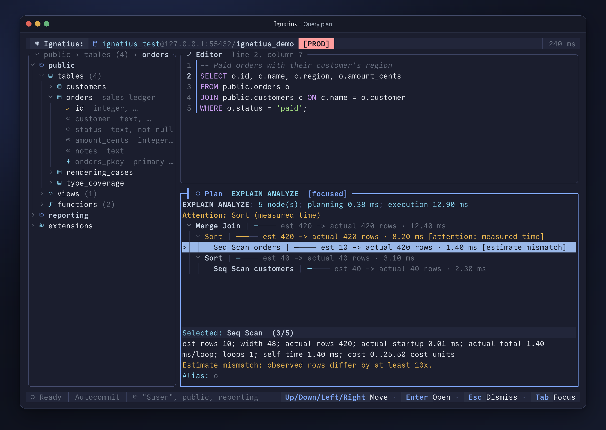
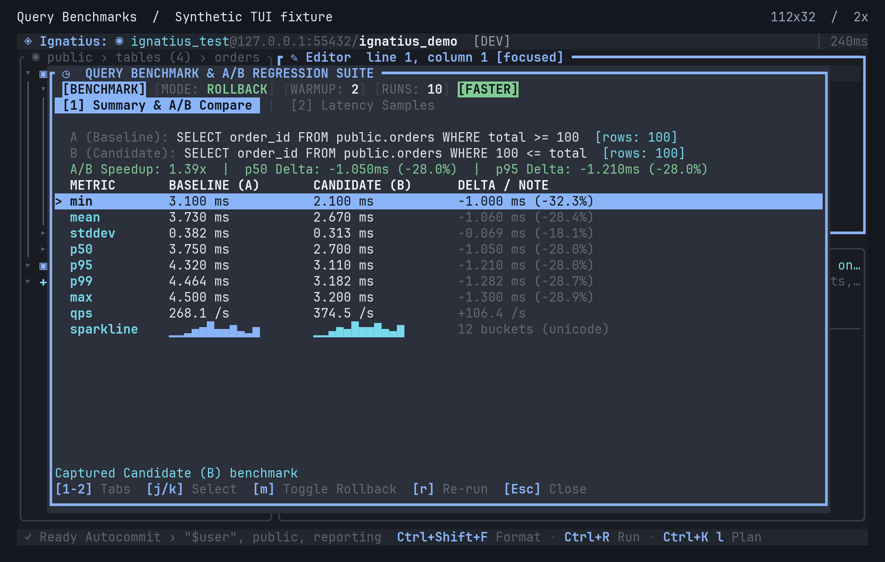

<div align="center">

<picture>
  <source media="(prefers-color-scheme: dark)" srcset="docs/assets/banner-dark.svg" />
  <source media="(prefers-color-scheme: light)" srcset="docs/assets/banner-light.svg" />
  
</picture>

A PostgreSQL workbench for the terminal that tells you what is true, and says so when it does not know.

[](https://github.com/tkomane/ignatius/actions/workflows/ci.yml)
[](docs/support/compatibility.md)
[](docs/security/data-handling.md)
[](LICENSE)

<a href="#what-it-is-like-to-use">Tour</a> &middot;
<a href="#quick-start">Quick start</a> &middot;
<a href="#everyday-keys">Keys</a> &middot;
<a href="#connecting">Connecting</a> &middot;
<a href="#scripting-and-ci">Scripting</a> &middot;
<a href="#reference">Reference</a>

<br />


</div>

Ignatius is a PostgreSQL client for the terminal, made to be pleasant to sit with for hours and honest about what it knows.

Many engineers explore in a friendly tool and fall back to `psql` when the database is real. Ignatius is meant to be the one you keep open for both. It tells you, in plain words, which database you are on, how the connection is actually protected, and what became of your last statement, including when the truthful answer is "unknown". It is driven from the keyboard, speaks only PostgreSQL, and asks nothing of you beyond a connection: no account, no telemetry, no cloud service.

**Calm.** One obvious next step on every screen, quiet colour, and motion that is brief and optional.<br />
**Honest.** Transport security read back from the server, production as a word you declare, uncertainty said out loud.<br />
**Yours.** One local binary that explores interactively and scripts the same way, with documented exit codes.

---

## What it is like to use

### You always know where you are

<p align="center">
  
</p>

The header answers the questions you should not have to ask. Which role, host and database. Whether this is production, because you declared it, not because a host name looked important. Whether the session is read-only, and whether a transaction is open or has failed. For the careful question, **Connection and auth details** in the palette says how the connection is really protected, read back from PostgreSQL itself, so `require` and `verify-full` are never described alike, and an answer the server will not give is shown as unknown. Switch colour off and every marker is still a word: `[PROD]`, `[READ ONLY]`, `[TX FAILED]`. When the terminal is narrow, decoration gives way first; those words stay.

### The answer, as it is

<p align="center">
  <picture>
    <source media="(prefers-reduced-motion: reduce)" srcset="docs/assets/motion/run-and-settle-still.png" />
    
  </picture>
</p>

While a statement runs, a small comet travels back and forth on a track under the word `Running` and the elapsed time. It never arrives anywhere, because PostgreSQL reports no progress for an ordinary query and Ignatius will not invent one. When the rows land, the word `Completed` glows briefly and settles, so even an identical rerun is visibly new. A NULL reads `[null]`, an empty string stays empty, and the text `NULL` stays text.

<p align="center">
  <picture>
    <source media="(prefers-reduced-motion: reduce)" srcset="docs/assets/motion/cancel-honestly-still.png" />
    
  </picture>
</p>

Press `Ctrl+C` and the status reads `Cancellation requested` until the server confirms it, because between the two the statement may still be running. If the connection drops mid-statement, you are told `Connection lost - query outcome unknown`, because that is the truth.

### Careful where it counts

<table>
  <tr>
    <td align="center" width="50%">
      
      <br />
      <sub>An error points at the token the server named.</sub>
    </td>
    <td align="center" width="50%">
      
      <br />
      <sub>A cell edit is reviewed before it is sent.</sub>
    </td>
  </tr>
</table>

When the server's error position maps to the statement you sent, Ignatius marks the token, names a likely cause and a next step, and keeps the technical fields one key away. Editing a cell produces the exact `UPDATE` for you to read before anything leaves the client, and it is refused on production and read-only sessions. On a production connection, statements you run from the editor that write wait for confirmation, and destructive ones ask you to type the database name. Benchmarks wrap each run in a rollback by default, and with rollback off they refuse to commit writes to production. These checks read SQL keywords and are advisory; `--read-only`, which PostgreSQL itself enforces, is the real control.

### Everything is a few keys away

<p align="center">
  
</p>

`Ctrl+P` opens a palette that finds any action by name. Saved queries, history and connection profiles open in the same kind of searchable list, with a preview beside it. `Ctrl+K` starts a two-key chord and shows a guide to everything that can follow, so nothing has to be memorised. When a list or dialog opens, the panes behind it step back into quiet ink, while the header and its production marker stay exactly as they were, and the footer offers only the keys that dialog will honour, keeping the way out for as long as anything fits. There is no modal editing to learn and no Vim to know. The mouse works too, and turning it off removes nothing.

### Yours to shape

<p align="center">
  <picture>
    <source media="(prefers-reduced-motion: reduce)" srcset="docs/assets/motion/theme-curtain-still.png" />
    
  </picture>
</p>

Seven built-in themes, from the warm dark of `atelier` to the archival light of `paper`, switch from the palette without reconnecting, and `ui.theme = "auto"` asks your terminal whether its background is light or dark. A new palette sweeps across the panes in about a third of a second; the header and footer change first, so a safety marker is never split between two themes. Text in every built-in theme meets 4.5:1 contrast against every surface, and tests hold it there; the ink behind an open dialog is deliberately quieter. Icons are optional and never carry meaning alone. Motion is brief, never the only signal, never plays over a confirmation, and is gone entirely with `ui.reduced-motion = true`.

<details>
<summary>All themes</summary>

<table>
  <tr>
    <td align="center" width="50%">
      
      <br />
      <sub><code>paper</code>: warm archival light.</sub>
    </td>
    <td align="center" width="50%">
      
      <br />
      <sub><code>material</code>: cool tonal dark.</sub>
    </td>
  </tr>
  <tr>
    <td align="center" width="50%">
      
      <br />
      <sub><code>field-industrial</code>: matte slate with amber signals.</sub>
    </td>
    <td align="center" width="50%">
      
      <br />
      <sub><code>light</code>: crisp daylight.</sub>
    </td>
  </tr>
</table>

</details>

<details>
<summary>More of the workbench</summary>

<table>
  <tr>
    <td align="center" width="50%">
      
      <br />
      <sub>Schema completion, <code>Ctrl+Space</code>.</sub>
    </td>
    <td align="center" width="50%">
      
      <br />
      <sub>Saved queries with a preview, <code>Ctrl+K o</code>.</sub>
    </td>
  </tr>
  <tr>
    <td align="center" width="50%">
      
      <br />
      <sub>Query plans: <code>Ctrl+K l</code> estimates without running, <code>Ctrl+K a</code> measures after you confirm.</sub>
    </td>
    <td align="center" width="50%">
      
      <br />
      <sub>Benchmarks, <code>Ctrl+K '</code>, rolled back by default.</sub>
    </td>
  </tr>
  <tr>
    <td align="center" width="50%">
      
      <br />
      <sub>Schema snapshots and drift, <code>Ctrl+K &quot;</code>.</sub>
    </td>
    <td align="center" width="50%">
      
      <br />
      <sub>SQL runbooks with a dry run, <code>Ctrl+K ?</code>.</sub>
    </td>
  </tr>
</table>

</details>

Every image and animation here is rendered from the interface's own widget buffers over synthetic data, inside a drawn window frame. No frame is tweened.

---

## Quick start

You need a Rust toolchain (rustup picks up the pinned version; the minimum is 1.90) and Docker for the practice database. Nothing has been published as a release yet, so Ignatius is built from source.

```bash
git clone https://github.com/tkomane/ignatius.git
cd ignatius
cargo xtask db up      # a disposable PostgreSQL 18 with synthetic data, on ports 55432 and 55433
cargo xtask run        # open Ignatius against it
```

Then try a few things:

- In the editor, type `SELECT label, value FROM rendering_cases;` and press `Ctrl+R`. A NULL, an empty string and the text `NULL` each look different in the results.
- On a new line, type `SELECT * FROM orders WHERE customer_id = 10482;` and, with the cursor on it, press `Ctrl+K l`. The estimated plan opens without the statement running; `Esc` returns to the results.
- Press `Tab` until the results have focus, choose a cell with the arrow keys, and press `Enter` to inspect it. `Esc` closes the inspector.
- Press `Ctrl+P`, type `theme`, and choose **Switch theme**.
- Press `Ctrl+K` on its own to see every chord, `F1` for help, and `Ctrl+Q` to quit.

When you are done, `cargo xtask db down` stops the database and deletes its data. The practice credentials are synthetic and live in `docker/dev.env`; `cargo xtask run` passes them for you.

To keep a copy, `cargo xtask install` builds a release binary into `~/.local/bin` (or `--dir PATH`). Then point it at your own database, letting the password come from `.pgpass`, `PGPASSWORD` or the masked prompt rather than the command line:

```bash
ignatius connect --check "postgres://app_user@db.internal:5432/analytics?sslmode=verify-full"
ignatius connect "postgres://app_user@db.internal:5432/analytics?sslmode=verify-full"
```

`--check` reports each stage of the connection without opening the workbench.

Ignatius is built and tested on macOS, Linux and Windows in CI. Warp on macOS and Windows Terminal on Windows 11 are first-class targets; hand-use acceptance on each platform is still in progress, and [the compatibility guide](docs/support/compatibility.md) records exactly what has been verified. The full layout wants 80x24; smaller terminals get a single pane.

---

## Everyday keys

| Key | What it does |
| --- | --- |
| `Ctrl+R` | Run the whole buffer (`F5` also works) |
| `Ctrl+T` | Run the statement at the cursor (`F9` also works) |
| `Ctrl+C` | Cancel the running statement |
| `Tab` | Move focus between the object tree, editor and results |
| `Ctrl+P` | Open the command palette |
| `Ctrl+K` | Start a two-key chord and list what can follow |
| `Ctrl+Space` | Show schema completion |
| `Ctrl+Shift+F` | Format the SQL buffer |
| `F1` | Show or hide help (`Ctrl+G` where `F1` is unavailable) |
| `Ctrl+Q` | Quit |

Every action has a named key, every chord is listed in help, and keys can be rebound under `[keys]` in the configuration file. The complete map, including every chord, is in [the reference](#two-key-chord-menu-ctrlk) below and in [the keymap](docs/design/keymap.md).

---

## Connecting

### URIs and Flags

```bash
# A connection URI. Keep the password out of it.
ignatius connect "postgres://app_user@db.internal:5432/analytics?sslmode=verify-full"

# Individual flags, asking the server to refuse writes for this session
ignatius connect --host db.internal --port 5432 --username app_user --dbname analytics --sslmode verify-full --read-only

# A named profile
ignatius connect @production-orders
```

Remote hosts default to `verify-full`. A TLS failure is never retried without TLS, and an option Ignatius cannot honour, such as `sslcrl` or `channel_binding`, is refused rather than quietly ignored.

### Configuration Profiles (`config.toml`)

Profiles and preferences live in `~/.config/ignatius/config.toml` on Linux and macOS, or `%APPDATA%\ignatius\config.toml` on Windows. A profile never holds a password.

```toml
schema_version = 1

[ui]
theme = "auto"              # "dark", "light", "high-contrast", "field-industrial", "material", "atelier", "paper", "custom", or "auto" (OSC 11)
mouse = true                # enable mouse clicks, drags, and scrolling
density = "comfortable"     # "comfortable" or "compact"
reduced-motion = false      # set true to disable animations
glyphs = "nerd-font"        # "unicode", "ascii", or "nerd-font"

[profiles.local-dev]
host = "127.0.0.1"
port = 55432
dbname = "ignatius_demo"
user = "ignatius_test"
sslmode = "disable"
environment = "dev"

[profiles.staging-analytics]
host = "staging-db.internal"
port = 5432
dbname = "analytics"
user = "analyst"
sslmode = "require"
environment = "staging"

[profiles.production-orders]
host = "orders-primary.internal"
port = 5432
dbname = "orders"
user = "readonly_admin"
sslmode = "verify-full"
environment = "prod"        # triggers [PROD] header badge and write guards
read-only = true            # enforces PostgreSQL session read-only transaction mode
```

With profiles configured and no target given, the workbench opens on a searchable picker, and `Ctrl+K n` brings it back later. `nerd-font` glyphs need a patched font and are never turned on unless you ask.

### Cloud Identity

A profile can obtain a short-lived token from your cloud's own command-line tool instead of a password, over an encrypted connection only:

- `auth = "entra"` runs `az account get-access-token --resource-type oss-rdbms`
- `auth = "aws"` runs `aws rds generate-db-auth-token`
- `auth = "gcp"` runs `gcloud sql generate-login-token`

The mechanism is tested end to end against a real PostgreSQL server over TLS. None of the three built-ins has yet been run against its cloud's own database; [the compatibility guide](docs/support/compatibility.md#cloud-identity-providers) will say when that changes.

### Where Passwords Come From

In order: the connection string, `PGPASSWORD`, a `.pgpass` file, then a masked prompt. A `.pgpass` readable by anyone but you is refused, with the `chmod` that fixes it. Passwords and tokens are held in memory only as long as they are needed, never written to the configuration file or history, and every displayable string that might carry a credential passes through one redaction path.

---

## What stays on your machine

- **Nothing goes anywhere else.** No telemetry, no update check, no account and no sync. Ignatius opens network connections only to the databases you point it at.
- **Result rows are never stored** unless you export them.
- **History records the SQL that ran, never what came back**, and skips any statement that mentions something like a password or token. Pause it with `Ctrl+K v`, skip it for one session with `--no-history`, or turn it off with `history.enabled = false`.
- **Unsaved buffers survive a crash**, unless the session started with `--no-history` or `history.enabled = false`, in which case nothing is kept; pausing with `Ctrl+K v` stops history but not the journal. The recovery journal holds editor text only, and you decide what happens to it:

```bash
ignatius recovery status
ignatius recovery restore --format sql > recovered.sql
ignatius recovery discard
```

Where each file lives, its permissions and its lifetime are listed in [data handling](docs/security/data-handling.md).

---

## Scripting and CI

The same binary runs without a screen. `ignatius query` reads SQL from an argument, a file or standard input and writes `table`, `csv`, `tsv`, `json`, `ndjson`, `markdown` or `insert`:

```bash
ignatius query "$DATABASE_URL" -c "SELECT order_id, total FROM orders" --format json

# Named parameters come from the environment, never from the command line
IGNATIUS_MONTH=2026-11 ignatius query "$DATABASE_URL" -f monthly.sql --param-env month=IGNATIUS_MONTH

# Stream a large result to disk; an interrupted export leaves a .partial file and exits 9
ignatius query "$DATABASE_URL" -c "SELECT * FROM audit_log" --format csv --output audit.csv
```

A production-classified target refuses anything that is not a read unless you pass `--allow-write`.

### Exit Codes

| Code | Meaning |
| --- | --- |
| `0` | Success |
| `1` | A check found what it was asked to fail on, such as `lint --fail-on`, `snapshot check --fail-on`, or `fleet` drift |
| `2` | Usage error |
| `3` | Configuration error |
| `4` | Could not reach the server |
| `5` | Reached the server; credentials rejected |
| `6` | TLS failed under the requested policy |
| `7` | The server reported an error for a statement |
| `8` | Cancelled |
| `9` | Export interrupted; a `.partial` file may remain |
| `70` | Internal error, always a defect worth reporting |

<details>
<summary>Every command, with an example</summary>

Descriptions follow each command's own `--help`.

```bash
# Setup, configuration, history and snippets
ignatius doctor
ignatius config validate
ignatius connect --check @production-orders
ignatius history list
ignatius history clear --yes
ignatius snippet list
ignatius snippet show cache-hit-ratio
ignatius completion zsh > ~/.zfunc/_ignatius

# Catalogue meta-commands such as \dt also work with -c
ignatius query "$DATABASE_URL" -c '\dt' --format json

# Lint SQL without a server, apply versioned migrations, generate a data dictionary
ignatius lint migrations/ --fail-on error --format sarif --output lint.sarif
ignatius migrate status "$DATABASE_URL" --dir migrations
ignatius migrate apply "$DATABASE_URL" --dir migrations --dry-run
ignatius docs "$DATABASE_URL" --schema public --format markdown --output docs/data-dictionary.md

# Table growth, partition plans, and restore drills into a scratch database
ignatius growth "$DATABASE_URL" --top 20 --fail-on critical
ignatius partition status "$DATABASE_URL" --schema billing
ignatius partition plan "$DATABASE_URL" --table billing.invoices --period monthly --start 2026-12-01 --count 3
ignatius restore-drill "$DATABASE_URL" --backup /backups/orders.dump --dry-run

# ER diagrams, DDL, streaming COPY, pg_dump and pg_restore, schema diffs
ignatius diagram "$DATABASE_URL" --schema public --format mermaid --output schema.mmd
ignatius ddl "$DATABASE_URL" --schema public --output schema.sql
ignatius import "$DATABASE_URL" --table orders --file orders.csv --dry-run
ignatius export "$DATABASE_URL" "SELECT * FROM orders" --format csv --output orders.csv
ignatius backup "$DATABASE_URL" --output orders.dump --format custom
ignatius restore "$DATABASE_URL" --input orders.dump --dry-run
ignatius diff "$DATABASE_URL" --source-schema public --target-schema reporting

# Server activity and locks, roles and RLS, routines, LISTEN and NOTIFY, maintenance
ignatius activity "$DATABASE_URL" --locks
ignatius audit "$DATABASE_URL" --section rls --schema public
ignatius run-routine "$DATABASE_URL" process_order -a 42 --rollback true
ignatius profile-routine "$DATABASE_URL" calculate_tax --format json
ignatius listen "$DATABASE_URL" order_events --timeout 30 --format jsonl
ignatius notify "$DATABASE_URL" order_events "order 1042 placed"
ignatius maintain "$DATABASE_URL" vacuum orders --analyze

# Statement statistics, indexes and bloat, WAL and checkpoints, connection pools
ignatius profile-queries "$DATABASE_URL" --sort mean --limit 20 --format table
ignatius index-advisor "$DATABASE_URL" --format table
ignatius wal-stats "$DATABASE_URL" --format table
ignatius pool-stats "$DATABASE_URL" --format table

# Masking rules, cross-database copy, synthetic fixtures, replication and server settings
ignatius mask-rules "$DATABASE_URL" --schema public
ignatius sync --source "$STAGING_URL" --target "$DEV_URL" --dry-run
ignatius seed "$DATABASE_URL" --schema public --rows 25 --format sql
ignatius replication "$DATABASE_URL" --section all --format table
ignatius cluster "$DATABASE_URL" --section settings --modified-only --format json

# Keyset browsing, plan diffs, result analytics, benchmarks, snapshots, runbooks, fleets
ignatius browse "$DATABASE_URL" --table public.orders --page-size 50 --format table
ignatius plan-diff "$DATABASE_URL" --baseline "SELECT * FROM orders" --candidate "SELECT order_id FROM orders WHERE order_id = 1" --analyze
ignatius analytics "$DATABASE_URL" -c "SELECT * FROM orders" --format parquet -o orders.parquet
ignatius bench "$DATABASE_URL" -c "SELECT * FROM public.orders" --warmup 2 --runs 10 --format table
ignatius snapshot capture "$DATABASE_URL" --schema public -o schema.snapshot.json
ignatius snapshot check "$DATABASE_URL" --against schema.snapshot.json --schema public --fail-on breaking
ignatius runbook --file incident.md --dry-run --format table
ignatius plan-history show --series orders-plan --format json
ignatius fleet --baseline @app-dev --candidate @app-staging --schema public --format json
```

</details>

---

## Reference

### Two-Key Chord Menu (`Ctrl+K`)

Press `Ctrl+K` and a guide appears listing every key that can follow; press one to act, or `Esc` to step back. Chords keep plain letters free for typing SQL.

<details>
<summary>Every chord</summary>

| After `Ctrl+K` | Description |
| --- | --- |
| `,` | Shrink the sidebar or editor share |
| `.` | Grow the sidebar or editor share |
| `z` | Zoom the focused pane or restore the layout |
| `b` | Show or hide the object tree |
| `p` | Open the command palette |
| `c` | Copy the selected result value |
| `u` | Generate a reviewed UPDATE from the selected cell |
| `q` | Format the SQL buffer |
| `n` | Choose a connection |
| `g` | Open result grid controls |
| `[` | Narrow the selected result column by 2 cells |
| `]` | Widen the selected result column by 2 cells |
| `l` | Show the estimated query plan |
| `a` | Measure the query plan (executes the statement) |
| `f` | Filter the object tree |
| `r` | Reload the object tree |
| `h` | Show or hide help |
| `x` | Expand the selected row down the screen |
| `i` | Inspect the selected cell |
| `s` | Search the statements that have run |
| `v` | Pause or resume recording statements |
| `d` | Show the selected object's definition |
| `y` | Show what depends on the selected object |
| `w` | Save the buffer as a named query |
| `o` | Open a saved query |
| `e` | Write the rows on screen to a file |
| `m` | Open the schema ER diagram |
| `j` | Open the server activity and locks dashboard |
| `t` | Open the roles, privileges, and RLS auditor |
| `k` | Open the schema diff and migration designer |
| `<` | Open the data import wizard |
| `(` | Open the routine runner and profiler |
| `>` | Open maintenance operations and pub-sub monitor |
| `%` | Open query performance and stat forensics |
| `^` | Open index advisor and bloat forensics |
| `&` | Open transaction, WAL, and checkpointer observability |
| `*` | Open connection pool and pgbouncer telemetry |
| `)` | Open data masking and anonymization rules |
| `|` | Open cross-database copy and sync pipelines |
| `+` | Open synthetic test fixture generator |
| `=` | Create new SQL editor buffer |
| `-` | Close current SQL editor buffer |
| `}` | Switch to next SQL editor buffer |
| `{` | Switch to previous SQL editor buffer |
| `\` | Toggle editor buffer split mode |
| `;` | Open snippet and scratchpad library |
| `!` | Lint the active SQL buffer |
| `#` | Open logical replication and slots manager |
| `@` | Open server config, HBA, extensions, and FDWs |
| `:` | Stop active psql watch loop |
| `_` | Open live data browser and batch CRUD |
| `/` | Open extended EXPLAIN and A/B plan diff |
| `$` | Open result profiler and HTML/Parquet export |
| `'` | Run query latency benchmark and A/B suite |
| `"` | Inspect schema snapshot and drift guard |
| `?` | Open interactive SQL Markdown runbook |

</details>

When unsaved buffers from an earlier session are waiting at startup, `Ctrl+K r` restores them and `Ctrl+K d` discards the journal.

### Mouse

Mouse capture is on by default. Click to focus a pane or select a cell, double-click to open what is selected, click a column header to cycle its sort, drag a column edge or split bar to resize, and scroll with the wheel (`Shift` scrolls results sideways). Hold `Shift` while dragging to select text the terminal's own way. Set `ui.mouse = false` to give every gesture back to the terminal; nothing becomes unreachable.

### Capabilities

<details>
<summary>What the workbench and the command line can do</summary>

Codes such as `026-schema-er-diagrams` name the feature in [the roadmap](docs/product/roadmap.md).

**Exploring and querying**

- An object tree of schemas, tables, views, functions, columns and more, with definitions (`Ctrl+K d`) and dependencies (`Ctrl+K y`).
- Up to 16 editor buffers with splits (`Ctrl+K =`, `Ctrl+K \`), a snippet library (`Ctrl+K ;`), saved queries (`Ctrl+K w`, `Ctrl+K o`), local formatting, and bounded bracketed paste.
- A results grid with local sorting, filtering, frozen and hidden columns (`Ctrl+K g`), an expanded row view (`Ctrl+K x`), and structured inspection of JSONB, arrays, ranges, and PostGIS and pgvector values where those extensions are installed (`Ctrl+K i`).
- Bounded `psql`-style meta-commands such as `\d`, `\dt`, `\conninfo`, `\x` and `\watch` (`Ctrl+K :` stops a watch). Ignatius is not a `psql` replacement and does not claim full meta-command compatibility.
- Query plans, estimated (`Ctrl+K l`) or measured after confirmation (`Ctrl+K a`), and extended `EXPLAIN (BUFFERS, WAL)` comparison (`Ctrl+K /`, `ignatius plan-diff`).

**Schema and data**

- ER diagrams in the terminal (`Ctrl+K m`) or as Mermaid, DOT, SVG, ASCII or Unicode (`ignatius diagram`). `026-schema-er-diagrams`
- Deterministic DDL for a schema or object (`Ctrl+K d`, `ignatius ddl`), with Toggle DROP and Load in Editor in the definition view. `027-deep-catalog-and-ddl-generator`
- Streaming `COPY` import and export (`Ctrl+K <`, `ignatius import`, `ignatius export`) and `pg_dump` and `pg_restore` with safe credential handling (`ignatius backup`, `ignatius restore`). `028-data-import-export-and-backup`
- Schema comparison and reviewable, transactional migration scripts (`Ctrl+K k`, `ignatius diff`). `030-visual-schema-designer-and-migrations`
- A live data browser with batch edits (`Ctrl+K _`) and bounded keyset paging (`ignatius browse`), data masking rules (`Ctrl+K )`, `ignatius mask-rules`), cross-database copy (`Ctrl+K |`, `ignatius sync`) and synthetic fixtures (`Ctrl+K +`, `ignatius seed`).

**Operating a server**

- Live server activity, lock blocker chains and health (`Ctrl+K j`, `ignatius activity`). `029-server-activity-and-locks-dashboard`
- Roles, privilege grants and row-level security policies (`Ctrl+K t`, `ignatius audit`). `031-roles-privileges-and-rls-auditor`
- Run a routine under a testing harness with rollback, or profile it (`Ctrl+K (`, `ignatius run-routine`, `ignatius profile-routine`). `032-plpgsql-routine-runner-and-profiler`
- `LISTEN` and `NOTIFY`, and vacuum, analyze and reindex with progress and a production confirmation (`Ctrl+K >`, `ignatius listen`, `ignatius notify`, `ignatius maintain`). `033-listen-notify-and-maintenance-ops`
- Statement statistics (`Ctrl+K %`), index and bloat analysis (`Ctrl+K ^`), WAL and checkpoints (`Ctrl+K &`), connection pools (`Ctrl+K *`), logical replication and slots (`Ctrl+K #`), and server settings, HBA rules, extensions and foreign data wrappers (`Ctrl+K @`).

**Automation**

- Offline SQL lint with SARIF output (`Ctrl+K !`, `ignatius lint`), versioned SQL migrations (`ignatius migrate`) and data dictionaries (`ignatius docs`).
- Growth audits (`ignatius growth`), range-partition plans (`ignatius partition`) and restore drills into a scratch database (`ignatius restore-drill`).
- Benchmarks rolled back by default (`Ctrl+K '`, `ignatius bench`), schema snapshots with drift gates (`Ctrl+K "`, `ignatius snapshot`), SQL runbooks with a dry run (`Ctrl+K ?`, `ignatius runbook`), local plan history (`ignatius plan-history`) and read-only comparison across profiles (`ignatius fleet`).

</details>

### Themes

`atelier` (warm espresso dark), `paper` (warm archival light), `material` (cool tonal dark), `field-industrial` (matte slate with amber signals), `dark` (cool midnight), `light` (crisp daylight) and `high-contrast` (black with bright ink, at 7:1 contrast or better). `auto` chooses light or dark from the terminal's background, and a `[theme]` table can build a `custom` palette on top of any built-in one. At 16 colours or with `NO_COLOR`, surfaces are left to the terminal and meaning is carried by words. See [theme tokens](docs/design/theme-tokens.md).

### Plain Mode

`ignatius --plain connect "$DATABASE_URL"` is a complete line-oriented client with no full-screen interface, colour or box drawing, for screen readers, `TERM=dumb` and pipes. It keeps the same production safeguards and states connection and transaction state in words.

---

## Documentation

- [Product vision](docs/product/vision.md): the problem, what makes Ignatius different, and what it will not become
- [Compatibility](docs/support/compatibility.md): supported PostgreSQL versions, terminals and platforms, and what has been verified where
- [Keymap](docs/design/keymap.md): every key, chord and mouse gesture
- [Diagnostics](docs/support/diagnostics.md): reading errors and exit codes
- [Data handling](docs/security/data-handling.md) and [threat model](docs/security/threat-model.md): what is stored, what never is, and why
- [Icons and motion](docs/design/icons-and-motion.md) and [theme tokens](docs/design/theme-tokens.md): how the interface stays decorative without becoming untrustworthy
- [Local development](docs/operations/local-development.md): the practice database, tests and `cargo xtask verify`
- [Release operations](docs/operations/release.md): the release checklist and its open gates
- [Status](docs/status.md): what is done and what is not
- [Contributing](CONTRIBUTING.md) and [security policy](SECURITY.md)

## License

Apache-2.0. See [LICENSE](LICENSE).
