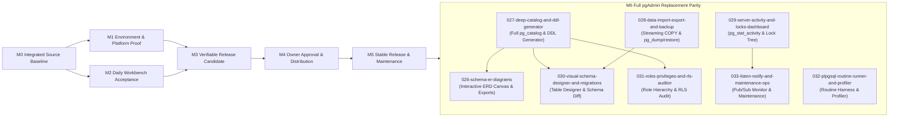

# Full pgAdmin Replacement Parity Architecture (M6: Features 026-033)

**Author:** Ignatius Architecture & Product Team  
**Status:** Planned Architecture (M6)  
**Authority:** Product Roadmap (`docs/product/roadmap.md`), Experience Roadmap (`docs/product/experience-roadmap.md`), Agent Delivery Plan (`docs/product/agent-delivery-plan.md`)  
**Target Milestone:** M6 (Features 026-033)  

---

## 1. Design Philosophy and Constitutional Alignment

`pgAdmin 4` is the de facto visual administrative environment for PostgreSQL. It provides comprehensive capabilities ranging from query execution and visual query plans to schema/ER diagrams, deep catalog navigation, graphical table/index designers, schema diffing, role management, live server activity dashboards, and routine debugging.

However, `pgAdmin 4` suffers from major design and operational limitations:
- **Heavyweight Runtime Overhead:** Built on a Python web backend and Chromium/Electron desktop wrapper, consuming hundreds of megabytes of memory and significant startup time.
- **Opaque Background Queries:** Issues dozens of uncoordinated, unreviewed catalog queries that can saturate replication slots, lock system catalogs, or introduce high latency over WAN connections.
- **Hidden Mutations:** Generates and executes DDL directly behind modal dialogues without always presenting the exact SQL statement for review.
- **Disconnected Automation:** GUI operations are isolated from command-line scripting and CI/CD pipelines, forcing engineers to switch tools when automating tasks.
- **Poor Accessibility and Terminal Unfriendliness:** Requires a desktop display server or web browser; cannot run over SSH or in headless environments.

Ignatius replaces `pgAdmin` entirely while rejecting these compromises. Ignatius delivers 100% of the daily and administrative capabilities of `pgAdmin 4` inside a single, high-performance, dependency-light binary (built with Rust, `ratatui`, and `tokio-postgres`) that excels both as an interactive terminal workbench and as a scriptable CLI.

### Architectural Invariants

Every feature in the M6 pgAdmin replacement suite adheres strictly to the Ignatius architectural tenets:

1. **Unidirectional Elm Architecture (`TEA`):**  
   All interactive state lives in `AppModel`. UI events produce explicit `Message` values processed by a pure `update` function. Side effects (database queries, file I/O, subprocess execution, clipboard interactions) are returned as explicit `Effect` values executed by asynchronous runtime workers. No widget or background task mutates state directly.
2. **Strict Bounds on Memory and Output:**  
   No operation may allocate unbounded memory. Catalog trees, schema diagrams, export buffers, and live server telemetry are bounded by explicit limits (e.g., node count ceilings, ring buffers, streaming iterators, and byte-budget caps).
3. **Explicit SQL Review Before Mutation:**  
   Every action that alters database state (DDL changes, table design modifications, role grants, cell updates, index creation, maintenance tasks, or backend termination) generates a formatted, syntax-highlighted SQL preview modal. The user must review the exact SQL and confirm with `Enter` before execution. There are zero hidden writes.
4. **Production Write-Guard Enforcement:**  
   Profiles designated as production (`environment = "prod"`) or read-only sessions (`--read-only`) strictly guard against destructive DDL, bulk updates, and administrative kills, requiring explicit multi-step confirmation or outright refusal.
5. **Dual TUI and Scriptable CLI Parity:**  
   Every visual tool in the TUI has a corresponding non-interactive CLI command supporting machine-readable output (`--format json|yaml|sql`) and deterministic exit codes, ensuring seamless integration into automation workflows.
6. **Graceful Tier Degradation and Accessibility:**  
   Visual features degrade deterministically across color tiers (`TrueColor`, `Indexed256`, `Basic16`, `None`) and glyph tiers (`nerd-font`, `unicode`, `ascii`). In `--plain` mode or screen-reader environments, all state is represented as linear, semantically labeled text.

---

## 2. Capability Matrix: pgAdmin 4 vs Ignatius (M0-M5 + M6)

| pgAdmin 4 Capability | Ignatius Feature Slug | Status | Ignatius Surface & Architectural Contract |
| --- | --- | --- | --- |
| **Query Tool & SQL Editor** | `001-foundation-vertical-slice`<br>`012-schema-completion`<br>`013-errors-at-cursor`<br>`025-gui-grade-experience` | Merged (`M0-M5`) | Multi-line syntax-highlighted editor, active line numbers, word-level undo/redo, Blink.cmp-style schema-aware autocomplete popup (`Ctrl+Space`), Trouble.nvim-style error pinning, and bounded bracketed paste. |
| **Visual Explain / Analyze** | `016-explain-analyze-plan-viewer` | Merged (`M0-M5`) | Interactive plan tree (`Ctrl+K l` / `Ctrl+K a`), estimated vs actual cost/timing breakdown, buffer hit tracking, and automatic expensive-node highlighting. |
| **Object Explorer (Catalog Tree)** | `001-foundation-vertical-slice`<br>`025-gui-grade-experience`<br>`027-deep-catalog-and-ddl-generator` | Core Merged (`M0-M5`), Deep Catalog Planned (`M6`) | Neo-tree style hierarchical sidebar (`Ctrl+B`), instant fuzzy filtering (`/`), full `pg_catalog` entity inspection, and deterministic DDL generation (`Ctrl+K d`). |
| **Schema & ERD Visualizer** | `026-schema-er-diagrams` | Implemented (`M6`) | Interactive terminal ERD canvas (`Ctrl+K m`), orthogonal box-drawing/Braille connectors, neighbourhood focus (1-hop / 2-hop), pure `src/diagram/` engine, `Session::schema_graph`, and CLI exporter (`ignatius diagram --format mermaid|dot|svg|ascii|unicode`). |
| **DDL Script Generator** | `027-deep-catalog-and-ddl-generator` | Implemented (`M6`) | Reconstructs complete, deterministic `CREATE` / `ALTER` / `DROP` DDL from `pg_catalog` for all object types; opens into interactive `Ctrl+K d` overlay (with Toggle DROP and Load in Editor) or CLI (`ignatius ddl`). |
| **Import / Export Wizard** | `021-format-first-export`<br>`028-data-import-export-and-backup` | Implemented (`M6`) | Streaming `COPY ... TO STDOUT` / `FROM STDIN` for CSV, TSV, JSONL, and SQL; interactive TUI import column mapper (`Ctrl+K <` / `import-data`); transactional rollback on error; scriptable CLI (`ignatius import`, `ignatius export`). |
| **Backup and Restore** | `028-data-import-export-and-backup` | Implemented (`M6`) | Subprocess-isolated orchestration of `pg_dump` and `pg_restore` (`ignatius backup`, `ignatius restore`) with dry-run command inspection, credential redaction, and bounded progress telemetry. |
| **Server Activity & Locks Dashboard** | `029-server-activity-and-locks-dashboard` | Implemented (`M6`) | Dedicated live dashboard tracking `pg_stat_activity`, `pg_locks`, blocking PID tree, query age, wait events, and guarded `pg_cancel_backend` / `pg_terminate_backend` via interactive `Ctrl+K j` overlay and scriptable `ignatius activity` CLI subcommand. |
| **Table / Schema Designer & Diff** | `030-visual-schema-designer-and-migrations` | Implemented (`M6`) | Form-driven TUI designer for tables/columns/constraints (`Ctrl+K k` / `schema-diff`); schema comparison between environments producing reviewable transactional migration SQL (`BEGIN; ... COMMIT;`) and scriptable `ignatius diff` CLI subcommand. |
| **Role, Grant & RLS Manager** | `031-roles-privileges-and-rls-auditor` | Implemented (`M6`) | Visual audit matrix of role hierarchy, object ACL grants, and Row-Level Security (`RLS`) policies (`USING` / `WITH CHECK`) via interactive `Ctrl+K t` (`security-audit`) overlay and scriptable `ignatius audit` CLI subcommand. |
| **PL/pgSQL Routine Runner & Debugger** | `032-plpgsql-routine-runner-and-profiler` | Planned (`M6`) | Discovers function/procedure signatures, prompts for typed parameters via safe parameter harness, executes in optional rollback savepoint, captures `RAISE NOTICE` stream and execution profile. |
| **LISTEN / NOTIFY & Maintenance Ops** | `033-listen-notify-and-maintenance-ops` | Planned (`M6`) | Interactive pub/sub event stream monitor (`LISTEN`/`NOTIFY`); guided maintenance runner for `VACUUM`, `ANALYZE`, and `REINDEX CONCURRENTLY` with live progress from `pg_stat_progress_*`. |

---

## 3. Detailed Specification Breakdown for Features 026-033

### Feature 026: Interactive Schema and Entity-Relationship (ER) Diagrams (`026-schema-er-diagrams`)

**Status: Implemented on `main`.** The pure `src/diagram/` engine, `pg_catalog` foreign-key graph extractor (`Session::schema_graph`), `ignatius diagram` CLI subcommand, and `Ctrl+K m` interactive TUI ER diagram overlay are fully implemented.

- **Objective:** Enable engineers to explore, understand, and document relational database schemas visually within the terminal without relying on third-party web tools or bloated GUI clients.
- **TUI Experience:**
  - **Interactive Canvas (`Ctrl+K m` or Command Palette):** Opens a dedicated full-screen or pane overlay presenting an interactive ER canvas.
  - **Entity Boxes:** Tables and views render with header pills, primary keys (`[PK]`), foreign keys (`[FK]`), unique markers (`[UQ]`), column names, and server data types.
  - **Orthogonal Edge Routing:** Foreign-key relationships render with clean orthogonal connectors using Unicode box-drawing (`┌─┐│└─┘`) and Braille characters in `TrueColor`/`Indexed256`/`Basic16`, with clear cardinality indicators (`1:1`, `1:N`, `M:N` junction tables).
  - **Neighbourhood Focus Filtering:** To eliminate visual clutter on 80-column terminals and dense schemas, the user can select an anchor table and filter the view to its direct 1-hop or 2-hop foreign-key neighbourhood. Unrelated entities are folded out of sight.
  - **Navigation and Zoom:** Smooth keyboard navigation (`h`/`j`/`k`/`l` or arrow keys), viewport panning, zoom levels (compact entity headers only vs full column view), and mouse drag/scroll support.
  - **ASCII Degradation:** In `--no-color` or ASCII mode, entities render as `+---+` boxes with standard ASCII directional edges (`--->`), fully readable without escape sequences.
- **CLI and Export Surface:**
  - Deterministic export command:
    ```bash
    ignatius diagram "$DATABASE_URL" --schema public --format mermaid --output schema.mmd
    ignatius diagram "$DATABASE_URL" --table orders --depth 2 --format dot --output orders.dot
    ignatius diagram "$DATABASE_URL" --format svg --output schema.svg
    ignatius diagram "$DATABASE_URL" --format ascii
    ```
- **Architectural Constraints:**
  - Pure model projection: The layout engine computes node coordinates in memory without side effects.
  - Bounded node cap: Canvases cap loaded entities at 200 nodes per view, prompting for neighbourhood focus if exceeded.

---

### Feature 027: Deep Catalog and DDL Inspector/Generator (`027-deep-catalog-and-ddl-generator`)

**Status: Implemented on `main`.** The pure `src/ddl/` engine, `pg_catalog` extractor (`Session::generate_ddl`), `ignatius ddl` CLI subcommand, and `Ctrl+K d` DDL overlay (with Toggle DROP and Load in Editor) are fully implemented.

- **Objective:** Provide exhaustive inspection and complete DDL script generation for every database object type supported by PostgreSQL.
- **Catalog Entity Expansion:**
  - Extends the Neo-tree sidebar and catalog queries to cover:
    - **Indexes:** B-tree, GIN, GiST, BRIN, SP-GiST, partial indexes (`WHERE` clause), and expression indexes. Surfacing index bloat and scan usage statistics.
    - **Constraints:** `PRIMARY KEY`, `FOREIGN KEY`, `UNIQUE`, `CHECK`, and `EXCLUDE` constraints.
    - **Triggers and Event Triggers:** Trigger function bindings, firing conditions (`BEFORE`, `AFTER`, `INSTEAD OF`), and per-statement/per-row execution.
    - **Sequences:** Start, increment, min/max, cycling, and current ownership relations (`IDENTITY` vs `SERIAL`).
    - **User-Defined Types:** Enums with labeled values, composite types, domain types with check constraints, and range types.
    - **Partitions:** Declarative partitioning hierarchy (`RANGE`, `LIST`, `HASH`), partition boundaries, and default partitions.
    - **Materialized Views:** Refresh status, populated state, and index bindings.
    - **Foreign Data:** Foreign Data Wrappers (`FDW`), foreign servers, user mappings, and foreign tables.
    - **Database Infrastructure:** Tablespaces, collation settings, and publication/subscription replication objects.
- **Deterministic DDL Reconstruction:**
  - Queries `pg_catalog` (using `pg_get_constraintdef`, `pg_get_indexdef`, `pg_get_viewdef`, `pg_get_functiondef`, and canonical formatting) to synthesize exact `CREATE`, `ALTER`, and `DROP` DDL scripts.
  - **Zero Hidden Writes:** The generated DDL is presented in a syntax-highlighted review overlay (`Ctrl+K d`), can be yanked/copied, or loaded directly into the SQL editor buffer for manual modification.
- **CLI Surface:**
  - Command-line DDL generation:
    ```bash
    ignatius ddl "$DATABASE_URL" public.orders
    ignatius ddl "$DATABASE_URL" public.order_status_enum --format sql
    ```

---

### Feature 028: Data Import/Export Wizard and Backup/Restore (`028-data-import-export-and-backup`)

**Status: Implemented on `main`.** The pure `src/transfer/` engine, `Session::execute_import` and `Session::execute_export` streaming extractors, `ignatius import`, `ignatius export`, `ignatius backup`, `ignatius restore` CLI subcommands, and interactive `Ctrl+K <` (`import-data`) TUI import wizard overlay are fully implemented.

- **Objective:** Bring enterprise-grade bulk data movement and database backup/restore into the terminal with streaming memory safety and strict write guards.
- **Streaming COPY Workflows:**
  - High-throughput streaming via PostgreSQL's binary and text `COPY ... TO STDOUT` and `COPY ... FROM STDIN` protocol.
  - Supports CSV, TSV, JSONL (newline-delimited JSON), SQL `INSERT`, and Parquet.
  - Streams data with constant memory overhead regardless of dataset size (100 MB or 100 GB).
- **Interactive TUI Import Wizard:**
  - **Header Detection & Type Guessing:** Reads sample rows from the input file and presents an interactive column-mapping grid.
  - **Target Column Mapping:** Users map input columns to table columns, select null value representations, and set encoding/quoting rules.
  - **Dry-Run & Transactional Guard:** Runs the import inside a transaction (`BEGIN; ... COMMIT;`). If any row violates constraints or types, Ignatius rolls back completely, reports the exact file line number and server error, and leaves the database uncorrupted.
  - **Production Guard:** Imports into production profiles require typing the database name or passing `--confirm-production`.
- **Backup and Restore Orchestration (`pg_dump` / `pg_restore`):**
  - Provides a safe subprocess harness wrapping native PostgreSQL client tools (`pg_dump`, `pg_restore`).
  - Generates and displays the exact CLI invocation for review before running.
  - Passes credentials strictly through redacted temporary environment variables (`PGPASSWORD`) or connection URIs; never logs or displays plaintext secrets.
  - Captures streaming progress and reports real-time percentage, byte count, and elapsed time in the TUI status bar.
- **CLI Commands:**
  - Scriptable import and export:
    ```bash
    ignatius import "$DATABASE_URL" --table customers --file customers.csv --format csv --delimiter ","
    ignatius export "$DATABASE_URL" "SELECT * FROM large_log" --format jsonl --output log.jsonl
    ignatius backup "$DATABASE_URL" --output backup.dump --format custom
    ignatius restore "$DATABASE_URL" --input backup.dump --clean
    ```

---

### Feature 029: Server Activity, Lock Blocker Tree, and Performance Monitor (`029-server-activity-and-locks-dashboard`)

**Status: Implemented on `main`.** The pure server activity and lock tree engine (`src/activity/`), `Session::server_activity`, `ignatius activity` CLI subcommand, and interactive `Ctrl+K j` (`server-activity`) TUI dashboard overlay are fully implemented.

- **Objective:** Provide a truthful, real-time diagnostic window into PostgreSQL server health, connection activity, and lock contention to troubleshoot performance bottlenecks.
- **Live Telemetry Surface (`Ctrl+K j` / `server-activity`):**
  - **Active Backends (`pg_stat_activity`):** Displays connected clients, process IDs (`PID`), client IP addresses, authenticated users, application names, transaction start times, query age, wait event types, and current query text.
  - **Lock Contention & Blocker Tree (`pg_locks`):** Visualizes blocking PID chains hierarchically:
    ```text
    PID 14201 (analyst_user) - ExclusiveLock on relation "orders" [Wait: 42s]
      └─ PID 14288 (app_backend) - waiting for RowShareLock [Wait: 38s]
      └─ PID 14302 (web_worker) - waiting for AccessShareLock [Wait: 15s]
    ```
    Surfaces exactly who holds the root lock and which backend processes are queued behind it.
  - **Database & Table Statistics:** Monitors transactions committed/rolled back, cache hit ratios, dead tuple counts, vacuum/analyze urgency, and temporary file usage.
  - **Statement Fingerprints (`pg_stat_statements`):** When the extension is enabled, aggregates top queries by total execution time, mean time, call count, and buffer usage.
- **Guarded Administrative Actions:**
  - Terminate or cancel backends (`pg_cancel_backend(pid)` and `pg_terminate_backend(pid)`).
  - **Multi-Step Safety Review:** Selecting a PID opens a modal stating PID, user, database, client IP, wait duration, and the full SQL text.
  - **Refusal in Read-Only Sessions:** Administrative terminations are disabled in read-only sessions (`--read-only`) and require explicit typed confirmation on production profiles.
- **CLI Commands:**
  - Non-interactive server health checks and activity export:
    ```bash
    ignatius activity "$DATABASE_URL"
    ignatius activity "$DATABASE_URL" --locks
    ignatius activity "$DATABASE_URL" --format json --output activity.json
    ```

---

### Feature 030: Visual Schema Designer, Migrations, and Diff Generator (`030-visual-schema-designer-and-migrations`)

**Status: Implemented on `main`.** The pure `src/migration/` schema diff, table designer, and migration generator engine, `Session::schema_snapshot` and `Session::schema_diff` extractors, `ignatius diff` CLI subcommand, and interactive `Ctrl+K k` (`schema-diff`) TUI overlay are fully implemented.

- **Objective:** Enable engineers to design, alter, and compare database schemas with visual guidance while maintaining strict, reviewable, transactional SQL migration contracts.
- **Visual Schema Designer:**
  - Form-based TUI modal for creating and modifying tables, columns, indexes, and constraints.
  - Interactive field inputs for column names, data types (with fuzzy autocomplete for native and custom types), nullability, default expressions, identity/auto-increment settings, and check constraints.
  - Foreign key builder with dropdown schema/table/column target selectors and referential action choices (`ON DELETE CASCADE`, `ON UPDATE RESTRICT`, etc.).
  - **Live DDL Preview:** A split preview panel updates the exact SQL DDL in real-time as form fields are altered.
- **Schema Comparison (Schema Diff):**
  - Compares two database schemas (e.g., local development vs staging, or schema `v1` vs schema `v2`).
  - Identifies differences in tables, columns, data types, nullability, defaults, indexes, foreign keys, and constraints.
  - Renders a clean tree diff highlighting additions (`+`), modifications (`~`), and deletions (`-`).
- **Transactional Migration Generator:**
  - Generates a clean, reviewable, idempotent SQL migration script:
    ```sql
    BEGIN;
    -- Step 1: Add new columns
    ALTER TABLE public.orders ADD COLUMN priority integer DEFAULT 1 NOT NULL;
    -- Step 2: Create indexes concurrently if requested
    CREATE INDEX CONCURRENTLY idx_orders_priority ON public.orders (priority);
    COMMIT;
    ```
  - **Strictly Transactional:** The migration script can be reviewed in the editor, edited, saved to disk, or applied explicitly. Ignatius never applies schema changes silently or automatically.
- **CLI Commands:**
  - Non-interactive schema diffing:
    ```bash
    ignatius diff @local-dev @staging-analytics --output migration.sql
    ignatius diff "$DEV_URL" "$PROD_URL" --schema public --format json
    ```

---

### Feature 031: Roles, Privileges, and Row-Level Security (RLS) Auditor (`031-roles-privileges-and-rls-auditor`)

**Status: Implemented on `main`.** The pure `src/audit/` security analysis engine, `Session::security_audit` extractor, `ignatius audit` CLI subcommand, and `Ctrl+K t` (`security-audit`) interactive TUI overlay are fully implemented.

- **Objective:** Give security auditors and database administrators clear visibility into PostgreSQL authentication hierarchies, permission grants, and row-level security policies.
- **TUI Experience (`Ctrl+K t` / `security-audit`):**
  - Interactive Security & RLS Auditor overlay with dedicated section views toggled via `s` or `1`/`2`/`3`:
    - `1` Roles & Memberships: role attributes (`LOGIN`, `SUPERUSER`, `BYPASSRLS`), connection limits, validity dates, and group inheritance.
    - `2` Row-Level Security (RLS): relation RLS flags, policy definitions (`USING` / `WITH CHECK`), and missing-policy warnings.
    - `3` Table Privilege Grants: tabular cross-reference of role permissions across relations.
  - Interactive `Up`/`Down` navigation and row selection.
  - `r` explicitly refreshes the live snapshot from `pg_catalog` and `information_schema`.
  - `e` or `Enter` loads reviewed remediation / role / grant SQL (`ALTER TABLE ... ENABLE ROW LEVEL SECURITY`, `CREATE POLICY`, `ALTER ROLE`, `GRANT` / `REVOKE`) directly into the SQL editor buffer as an undoable edit (`Ctrl+Z`), with zero hidden writes.
  - `Esc` closes the overlay without side effects.
- **Role Hierarchy & Membership Browser:**
  - Visualizes role inheritance trees (`pg_roles` and `pg_auth_members`), highlighting superuser attributes, login permissions, bypass RLS rights, connection limits, and role validity dates.
- **ACL Privilege Grant Matrix:**
  - Displays a clean tabular cross-reference of roles against schemas, tables, sequences, and routines.
  - Maps standard PostgreSQL privilege bits: `SELECT` (`r`), `INSERT` (`a`), `UPDATE` (`w`), `DELETE` (`d`), `TRUNCATE` (`D`), `REFERENCES` (`x`), `TRIGGER` (`t`), and `EXECUTE` (`X`).
  - Clear distinction between direct grants and inherited group permissions.
- **Row-Level Security (RLS) Policy Auditor:**
  - Audits `pg_class.relrowsecurity` and `pg_policy` across all relations.
  - Flags multi-tenant tables where RLS is disabled or where policies are missing for specific commands (`SELECT`, `INSERT`, `UPDATE`, `DELETE`).
  - Displays policy definitions in full, highlighting `USING` (read visibility) and `WITH CHECK` (write validation) expressions.
- **Reviewed Grant/Revoke & Policy Generator:**
  - Form-driven interface for generating `GRANT`, `REVOKE`, `ALTER TABLE ... ENABLE ROW LEVEL SECURITY`, and `CREATE POLICY` statements.
  - Every change presents exact SQL for review before execution.
- **CLI Commands:**
  - Automated security and compliance audits:
    ```bash
    # Audit roles, table Row-Level Security (RLS) posture/policies, and privilege grants
    ignatius audit "$DATABASE_URL"

    # Focus on Row-Level Security policies in the public schema
    ignatius audit "$DATABASE_URL" --section rls --schema public

    # Export a machine-readable JSON security and compliance report atomically to disk
    ignatius audit "$DATABASE_URL" --format json --output security-audit.json
    ```

---

### Feature 032: PL/pgSQL Routine Runner and Profiler (`032-plpgsql-routine-runner-and-profiler`)

- **Objective:** Streamline the execution, testing, and performance profiling of PostgreSQL stored procedures, functions, and triggers.
- **Signature Discovery & Typed Argument Prompt:**
  - Discovers routine signatures (`pg_proc`), argument names, parameter types, modes (`IN`, `OUT`, `INOUT`, `VARIADIC`), and default values.
  - Reuses Feature 022's safe parameter boundary to prompt for typed arguments with syntax highlighting and input validation.
- **Safe Execution Test Harness:**
  - Offers a one-key toggle to run procedures within a temporary `SAVEPOINT` followed by an automatic `ROLLBACK`, enabling developers to test procedures with mutations without persisting side effects.
  - Captures multi-set tabular returns (`SETOF record`, `TABLE(...)`, or `REFCURSOR`) and renders them directly in the Results grid.
- **Notice and Profiling Stream:**
  - Captures asynchronous `RAISE NOTICE`, `RAISE WARNING`, and `RAISE INFO` diagnostic messages with exact timestamps and call line numbers.
  - Integrates with `plpgsql_check` when available to detect unused variables, dead code, type mismatches, and query plan inefficiencies inside function bodies.
  - Records execution timing per call step.
- **CLI Commands:**
  - Headless routine execution and profiling:
    ```bash
    ignatius run-routine "$DATABASE_URL" calculate_monthly_tax --param year=2026 --param month=11 --rollback
    ignatius profile-routine "$DATABASE_URL" process_order_queue
    ```

---

### Feature 033: LISTEN/NOTIFY Monitor and Guarded Maintenance Operations (`033-listen-notify-and-maintenance-ops`)

- **Objective:** Provide a dedicated pub/sub monitor for asynchronous messaging and a guided, transparent workbench for critical database maintenance routines.
- **Asynchronous LISTEN/NOTIFY Monitor:**
  - Dedicated TUI event monitor that establishes a dedicated background connection and issues `LISTEN <channel>`.
  - Captures incoming server notifications asynchronously without blocking the primary query session.
  - Renders a live scrolling log of notifications with timestamp, channel name, sending backend PID, and decoded JSON or text payload.
  - Includes a guarded `NOTIFY` sender modal with channel selection and payload editor for manual event dispatch testing.
- **Guarded Maintenance Runner:**
  - Guided interface for common PostgreSQL maintenance operations:
    - `VACUUM (VERBOSE, ANALYZE)`
    - `VACUUM FULL` (with strong table-lock warnings)
    - `ANALYZE`
    - `REINDEX TABLE CONCURRENTLY`
  - **Bloat Estimation & Impact Guidance:** Displays estimated dead tuple bloat and warns of lock levels (`AccessExclusiveLock` vs `ShareUpdateExclusiveLock`) before invocation.
  - **Live Progress Telemetry:** Connects to PostgreSQL progress reporting views (`pg_stat_progress_vacuum`, `pg_stat_progress_cluster`, and `pg_stat_progress_create_index`), displaying live phase indicators, completed blocks, and percentage progress bars.
  - **Production Confirmation:** Maintenance operations on production profiles require explicit confirmation.
- **CLI Commands:**
  - Scriptable event listening and maintenance execution:
    ```bash
    ignatius listen "$DATABASE_URL" order_events --timeout 30 --format jsonl
    ignatius notify "$DATABASE_URL" order_events '{"order_id": 9942, "status": "shipped"}'
    ignatius maintain vacuum "$DATABASE_URL" --table orders --analyze --verbose
    ignatius maintain reindex "$DATABASE_URL" --table orders --concurrently
    ```

---

## 4. Architectural Sequencing and Dependency Roadmap

The following Mermaid diagram illustrates how existing foundational milestones (`M0` through `M5`) flow into Milestone 6 (`M6: Full pgAdmin Replacement Parity`), establishing the implementation and verification dependencies for Features 026 through 033:



---

## 5. Verification Gates and Acceptance Criteria

Every feature in Milestone 6 must satisfy the same stringent quality gates defined in `docs/product/roadmap.md` and `docs/operations/agent-playbook.md`:

1. **Focused Component Tests:** Comprehensive reducer unit tests in sidecar `tests.rs` modules validating pure state transitions and message handling without I/O.
2. **Deterministic CLI Contract Tests:** Automated integration tests in `tests/` asserting exact exit codes, stdout formatting, and stderr diagnostics for all CLI subcommands.
3. **Database Version Compatibility Matrix:** Live testing across all supported PostgreSQL major versions (14, 15, 16, 17, and 18) under plain, TLS, and Unix-domain socket fixtures.
4. **Terminal and Color Depth Degradation:** Verification across 4 color depths (`TrueColor`, `Indexed256`, `Basic16`, `None`) and standard viewport geometries (`100x30`, `80x24`, `60x20`, `30x6`).
5. **Screen Reader and Plain Mode Verification:** Verification under `--plain` mode confirming full semantic disclosure without ANSI escape sequences.
6. **Resource and Safety Bounds:** Enforcing strict memory ceilings, streaming chunking, transaction rollbacks on error, and write-guard prompts on production targets.
