# Roadmap

**Reconciled 2026-11-07; replanned 2026-09-04.** Deliver a PostgreSQL workbench that is easy to discover,
truthful under pressure and dependable in both a terminal and a script.
The implemented source through Feature 025 (`US1-US10`, `T001-T059`) and the
Waves 13-15 4-tier TUI elevation and showcase suite (`PR53`, `PR54`, `PR57`) is
consolidated on `main`. Resume from `main` and the [current status](../status.md);
its dated PR/check records distinguish integrated code from remaining product,
platform and release acceptance.

Feature 025 `US1-US10` are implemented and merged on `main` (`PR41`, `PR42`,
`PR43`, `PR46`, `PR51`, `PR53`, `PR54`, `PR57`): pasted SQL (`US1`), 4-tier painted surfaces across four colour
depths (`US2`), dense grid headers and range indicators (`US3`), honest
connecting stages (`US4`), manual and `ui.theme = "auto"` OSC 11 luminance
themes (`US5`), mouse verb-table dispatch and default capture with keyboard
parity (`US6`), resizable and zoomable panes with `comfortable`/`compact`
density (`US7`), quiet `200 ms` threshold-gated chrome capsules (`US8`), 80%
height / 60% syntax-highlighted preview command palettes (`US9`), and the bounded `1.4 s` boot
reveal (`US10`). Cross-cutting packages `W02`, `W03`, `W04`, `W06` subprocess
tests, `W08`/`W09` automated reference-journey (`J1-J8`), viewport-matrix
(`100x30`, `80x24`, `60x20`, `30x6`), and 7-scene `112x32` workbench showcase suites, `W10` operational resource bounds
(`W10-008` and `tests/resource_bounds_contract.rs`), `W11`/`W13` release trust
verification (`xtask release sbom` and `trust verify`), and 100% sidecar
`tests.rs` extraction (`PR44`, `PR45`, `PR47`, `PR48`, `PR49`, `PR50`, `PR52`) also
passed all hosted CI and CodeQL checks on `main`. Neither source integration
nor automated checks closes native terminal hand-use acceptance or release
readiness.

The local T059 diagnostic's 1 MiB medians were 138.342 ms/17.063 MiB RSS, with
exact 51,081-cell parity, and `tests/resource_bounds_contract.rs` measured
`p50 = 1.09 ms`, `p95 = 2.40 ms` across 100 local input/palette/completion
actions and `p50 = 3.85 ms`, `p95 = 4.10 ms` across 100 1,000-row wide-Unicode
grid interactions. Detailed source-bound results remain in
[verification](../operations/verification.md).

W07-064 and 001 T055a are complete for automated Windows Terminal and ConPTY
restoration. The 24-case Guard matrix on Windows Server 2025 x64 observed
the original console modes, cursor, bracketed paste and main screen after
every exit. [Windows restoration evidence](../operations/verification.md#native-windows-bracketed-paste-restoration---20-november-2026)

The automated Windows 11 ARM64 PowerShell workbench and Linux xterm journeys
also restored terminal state after live PostgreSQL queries. Hand use in
Windows Terminal, Linux desktop terminals and Warp remains open under W08.
Live cloud-provider account evidence remains separate work.
[Windows 11 journey](../operations/verification.md#windows-11-powershell-workbench---20-november-2026)
[Linux xterm journeys](../operations/verification.md#linux-xterm-renderer-and-restoration---19-november-2026)

W11 may examine historical owner-clone release/inventory prototypes retained in
the pre-cleanup recovery bundle, but their existence does not adopt an older
trust or privacy contract. No release or deployment follows from consolidation.
On 25 October, local M1 work also patched the current dependency advisories,
refreshed five-major PostgreSQL/TLS evidence and closed a Unix startup-signal
window. Feature 025 keyboard panes T039/T041 and density T040 are implemented
locally, with T038 test implementation complete. Feature 018 T037-T040 now
repair the reproduced narrow-review disclosure failure across five sending
surfaces and passed the complete local verifier (1,270 harness cases). W07-062
also proves actual error/panic guard restoration in owned macOS PTYs. W10-007
measured oversized-value/notice retention and exposed silent CSV truncation;
W10-009 now discloses buffered truncation and W10-010 repairs complete-row/
partial-flush reporting. Both passed the combined local gate with Feature 015
T042's scrollable, input-owning help (1,315 harness cases). Native/platform and
different-family acceptance remain distinct from those implementation tasks.
W10-008 retains distinct notice, aggregate-result and incoming-allocation
contracts; observed RSS peaks are not memory ceilings. W10-011's 12 real-writer
pacing samples preserve all output bytes with distinct small/large-value RSS.
W10-012 notice admission/accounting is implemented locally in `d65024b`, with
1,370 combined harness cases and reviewed synthetic buffers. Published `fda16f8`
also passed hosted platform/MSRV, PG14/18 plain/TLS and real-socket gates; native
hand-use remains separate. W10-013's execution-wide retained-data contract is
accepted at published `54056c2`: local 1,431 outer cases/112 styled buffers,
all five PostgreSQL majors plain/TLS, actual socket, pinned/MSRV/platform and
CodeQL checks. In October 2026, W07's published `65cf237` repeated three native
Windows ConPTY control passes and completed a separate cursor calibration.
The sensor tracked native setters and main-screen VT. Its alternate-screen
cursor result stayed constant, leaving the matrix blocked at that stage. The
experiment moved to the explicitly dispatched
`windows-conpty-diagnostic.yml` workflow while routine CI retained all platform
product suites. CLI cancellation and complete resource acceptance remain
separate from these results.
**024 Explicit retained-result refresh** remains part of the integrated feature
chain; the later experience work preserves its source-bound, deliberate action.

| Read this for | Authority |
| --- | --- |
| Product intent and users | [Vision](vision.md), [personas](personas-and-jobs.md), [experience rationale](experience-roadmap.md) |
| Evidence behind this plan and every existing feature | [Dated baseline and feature inventory](planning-baseline.md) |
| What success looks like | [Product outcomes and acceptance journeys](acceptance.md) |
| Assignable work, dependencies and definitions of done | [Agent delivery plan, W01-W16](agent-delivery-plan.md) |
| Architecture and extension boundaries | [Components](../architecture/containers-and-components.md), [runtime](../architecture/runtime-state.md), [trust context](../architecture/context.md) |
| Full pgAdmin replacement parity plan (M6) | [Full pgAdmin replacement parity plan](../architecture/pgadmin-parity-plan.md) |
| How agents take and return work | [Agent playbook](../operations/agent-playbook.md) |
| What is actually done now | [Status](../status.md), current worktree, each feature's `tasks.md` |

## Product scope

The complete product joins six outcomes: trustworthy connection and execution
state; low-recall query authoring; useful result exploration; recoverable
failure; private, consistent automation; and verifiable installation and support.
[O1-O6](acceptance.md) maps each to scenarios and delivery owners.

The intended release scope includes the foundation, existing connection and
query workflows, and experience slices 012-024 once their acceptance is proved.
Feature 008 supplies the release contract. Local implementation, integration,
platform evidence, release readiness and publication are separate states.
Unchecked evidence remains work even when implementation tasks are ticked.

The product stays local-first and PostgreSQL-specific, with a pure state model,
one scriptable binary, deliberate side effects and explicit unsupported
capabilities. The OS credential store was rejected by ADR-0011; libpq was closed
without implementation by ADR-0012. Neither is an open delivery dependency.
The constitutional non-goals in the vision remain outside this roadmap.

## Milestones and exit gates

Milestones express dependency order, not dates or version numbers. `Cargo.toml`
remains the product-version authority. Completion requires the evidence named
below; broadening the feature list does not move a milestone forward.

| Milestone | User-visible result | Work packages | Exit gate |
| --- | --- | --- | --- |
| M0 Reproducible integrated product | The local feature chain is coherent and reviewable | W01 | Intended changes preserved, integrated focused/full verification recorded, exact source boundary known |
| M1 Trustworthy across supported environments | Connection, query, result and recovery behaviour stay truthful on declared platforms | W02-W08, W10 | Interleaving/privacy/protocol checks, PostgreSQL matrix, native/provider evidence, restoration and resource/recovery requirements satisfied for claimed scope |
| M2 Proven daily experience | A newcomer finds the workflow and a daily user can rely on it | W08-W10 | First-use targets assessed, daily-use blockers fixed and affected scenarios repeated; no unresolved material safety misunderstanding |
| M3 Verifiable release candidate | An operator can identify, verify, install and roll back the candidate | W11-W13 plus M1/M2 | Canonical technical evidence, inventory, signatures/provenance, runtime privacy, recovery and support prerequisites accepted; any final owner gate stays blocking in 008 T033 |
| M4 Owner-approved distribution | The reviewed candidate reaches only the authorized destination | W14 | Explicit owner decision, readiness check passes after required authorization, and authorized bytes/metadata independently verified; T033/T035/status/catalogue accurately closed |
| M5 Supported daily tool | Patches keep pace with real usage and supported environments | W15; W16 when justified | Each maintenance cycle closes reported failures and repeats affected release gates; new scope starts from observed jobs |
| M6 Full pgAdmin replacement parity | Every daily and administrative job for which users reach for pgAdmin is completable in the terminal and CLI | W16 (Features 026-033) | Schema/ER diagrams, deep catalog/DDL generator, streaming COPY/backup, server activity/locks, guided schema designer/diff, role/RLS auditor, routine runner and maintenance ops specified, implemented and verified under M1-M3 gates |
| M7 Enterprise Observability & Query Performance Forensics | High-resolution slow query profiling, cache diagnostics, and lock-free bloat intelligence | W16 (Features 034-037) | `pg_stat_statements` slow query profiling, buffer hit ratio diagnostics, transaction freeze monitoring, and zero-lock index bloat intelligence |
| M8 Cross-Environment Data Synchronization, Masking & Seeding | Privacy-compliant test data masking, deterministic synthetic seeding, and cross-environment sync | W16 (Features 038-040) | PII rule-based masking, deterministic synthetic relational data generation adhering to foreign-key DAGs, and reviewable transactional sync scripts |
| M9 Multi-Buffer Editor Workspaces & Scratchpad Persistence | Multi-tab query editing and crash-resilient local scratchpad session persistence | W16 (Features 041-043) | Multi-tab editor workspaces (`Ctrl+K =`/`Ctrl+K -`), persistent named scratchpads under `config_dir/snippets`, and automatic unsaved buffer crash recovery under `IGNATIUS_DATA_DIR` |
| M10 Developer Workflow & CI Automation | Unsafe SQL is caught before CI, migrations apply once with an audit trail, and schema documentation is reproducible | W16 (Features 044-046) | Offline lint findings and thresholds, checksummed forward-only migration ledger with drift refusal, deterministic data dictionary export |
| M11 Operational Data Lifecycle | Backups are proven restorable, partitions are managed deliberately, and growth/retention risks are visible | W16 (Features 047-049) | Restore-drill evidence, reviewed partition lifecycle DDL, bounded retention and growth audit |
| M12 Complete psql & Server/Replication Parity | Interactive `psql` backslash commands, bounded `\watch`, logical replication/slot safety, and server config/HBA/FDW/tablespace management | W16 (Features 050-052) | Pure meta-command lexer & bounded watch timer, `pg_publication`/`pg_subscription`/`pg_replication_slots` safety manager, `pg_settings`/`pg_hba_file_rules`/`pg_available_extensions`/FDW/tablespace inspector |
| M13 Live Data CRUD, Plan Diff & Analytics | Keyset-paginated data browser with reviewed multi-row CRUD, `EXPLAIN (BUFFERS, WAL)` A/B plan diffing, and result sparklines/Parquet export | W16 (Features 053-055) | Table data browser with reviewed INSERT/DELETE/batch UPDATE, baseline plan diffing, terminal histograms/sparklines, HTML/Parquet export |
| M14 Query Benchmarks, Schema Snapshots & Runbooks | Multi-iteration A/B query latency benchmarking, canonical SHA-256 schema snapshots with drift CI gates, Markdown SQL runbooks, and Material Tonal polish | W16 (Features 056-058) | Rollback-safe warmup/measured benchmark engine with regression gates, zero-row `pg_catalog` snapshot diffing, Markdown/`-- @cell` runbooks with write guards, built-in `material` theme |
| M15 Structured Values, Plan History & Fleet Health | Inspect structured cells, track query plan regressions and compare named environments | W16 (Features 059-061) | Reviewed typed edits, digest-only local plan history and bounded read-only fleet comparisons |
| M16 Editorial High-Art TUI Aesthetic & Themes | Curated Obsidian/Paper gallery palettes, elevated rail keycaps, recessed modal badges, and editorial chrome typography | W16 (Feature 062) | WCAG-verified `atelier` and `paper` themes, `Theme::keycap` / `Theme::recessed_pill`, right-aligned footer hints, Spotlight palette input strip, 14 2x showcase PNGs |

M9 is delivered in source as of 2026-11-12: Features 041, 042 and 043 are
implemented, and each carries focused and full verification recorded in
`docs/status.md`. Native hand use, screen-reader use and live terminal resize
remain evidence gaps under M1/M2 rather than M9 source work.

M10 is delivered in source as of 2026-11-12: the linter, migration runner and
documentation generator are implemented and covered by focused and full gates.
The milestone is deliberately CLI-first because those are jobs a team performs
in a repository or release pipeline, not only inside a terminal session.

M11 is delivered in source as of 2026-11-12: Features 047, 048 and 049 are
implemented and carry focused and full verification in `docs/status.md` Wave 37.

- **`047-restore-drills`** [Implemented]: `ignatius restore-drill` restores an
  archive into a scratch database created from `TEMPLATE template0`, compares
  user relation counts with the source, never restores into the source, and
  follows an explicit keep/drop retention policy. Production targets require
  `--allow-production`; `--dry-run` shows the plan with credentials redacted.
- **`048-partition-lifecycle`** [Implemented]: `ignatius partition status`
  reports range, list and hash partition sets within fixed bounds, and
  `ignatius partition plan` emits reviewed aligned DDL with overlap refusal and
  optional expiry. It has no apply command; reviewed SQL is applied through the
  migration ledger.
- **`049-retention-and-growth-audit`** [Implemented]: `ignatius growth` is a
  read-only, catalog-statistics audit for sequence exhaustion, vacuum debt and
  partitioning candidates, bounded to 200 relations and 200 sequences.

M12 is delivered in source as of 2026-11-18: Features 050, 051 and 052 are
implemented and recorded in `docs/status.md` Wave 39.

- **`050-psql-metacommands-and-watch-mode`** [Implemented]: Interactive TUI and
  headless `-c` backslash meta-commands (`\d`, `\d+`, `\dt`, `\dt+`, `\dv`,
  `\dm`, `\di`, `\ds`, `\dn`, `\du`, `\dg`, `\df`, `\dx`, `\l`, `\l+`,
  `\conninfo`, `\x`, `\timing`, `\?`/`\h`) plus a bounded `[1..3600]s` / 1000
  iteration `\watch` polling loop (`Ctrl+K :` / `stop-watch`) with explicit
  `\!` shell-escape refusal.
- **`051-logical-replication-and-slot-manager`** [Implemented]: Bounded
  inspection of `pg_publication`, `pg_subscription` (redacted `conninfo`), and
  `pg_replication_slots` WAL retention risks via `ignatius replication` and
  `Ctrl+K #` (`logical-replication`) with reviewed SQL insertion.
- **`052-server-config-hba-and-infra-catalog`** [Implemented]: Bounded
  inspection of `pg_settings`, `pg_hba_file_rules` risk classification,
  `pg_available_extensions`, `pg_tablespace`, and FDW/foreign servers (masked
  options) via `ignatius cluster` and `Ctrl+K @` (`cluster-config`).

M13 is delivered in source as of 2026-11-18: Features 053, 054 and 055 are
implemented and recorded in `docs/status.md` Wave 40.

- **`053-live-data-browser-and-batch-crud`** [Implemented]: Keyset-paginated
  table browsing (`ignatius browse`, `Ctrl+K _` / `data-browser`) using tuple
  cursors bounded at 500 rows/page, plus reviewed transactional `INSERT`,
  `UPDATE`, and `DELETE` synthesis refusing keyless writes.
- **`054-explain-buffers-wal-and-plan-diff`** [Implemented]: Rollback-safe
  `EXPLAIN (ANALYZE, BUFFERS, WAL, SETTINGS, FORMAT JSON)` telemetry extractor
  and A/B plan comparison engine (`ignatius plan-diff`, `Ctrl+K /` / `plan-diff`).
- **`055-result-analytics-and-rich-exports`** [Implemented]: Zero-query column
  statistics, p50/p95, histograms, and sparklines (`Ctrl+K $` / `result-analytics`)
  plus dependency-free HTML and streaming Apache Parquet exports (`ignatius analytics`,
  `Ctrl+K e`).

M14 is delivered in source as of 2026-11-19: Features 056, 057 and 058 plus the
built-in `material` theme and Material 3 quiet-precision polish are implemented
and recorded in `docs/status.md` Wave 41.

- **`056-query-benchmarks-and-regression-suite`** [Implemented]: Warmup-separated
  multi-iteration query benchmark engine (`DEFAULT_WARMUP_RUNS = 2`,
  `DEFAULT_MEASURED_RUNS = 10`) with Welford mean/stddev, `p50`/`p95`/`p99`
  percentiles, `qps`, 12-bucket latency sparklines, rollback-safe `BEGIN`/`ROLLBACK`
  per-iteration isolation, and A/B regression gate (`ignatius bench`,
  `Ctrl+K '` / `query-bench`).
- **`057-schema-snapshots-and-drift-guard`** [Implemented]: Bounded zero-row-read
  `pg_catalog` snapshot capture and deterministic lowercase SHA-256
  `fingerprint_sha256` across PostgreSQL 14-18, plus `Breaking`/`Warning`/`Info`
  drift diffing with configurable fail thresholds (`ignatius snapshot capture|check`,
  `Ctrl+K "` / `schema-snapshot`).
- **`058-interactive-sql-notebook-runner`** [Implemented]: Markdown fenced SQL
  runbook parser (`-- @name:`, `-- @readonly`, `-- @expect-rows:`) and local
  `-- @cell` buffer splitter with `classify_all` write guards, offline `--dry-run`
  planning, and Markdown/JSON/plain/table reports (`ignatius runbook`,
  `Ctrl+K ?` / `sql-runbook`).

M15 has three source specifications and their accompanying evidence tasks.

- [059 Structured Type and JSONB Inspector](../../specs/059-structured-type-and-jsonb-inspector/spec.md)
  extends Cell Detail with navigation, a raw view and reviewed editing.
- [060 Query Plan History and Regression Timeline](../../specs/060-query-plan-history-and-regression-timeline/spec.md)
  records local observations across index and schema changes.
- [061 Multi-Target Environment Diff and Fleet Health](../../specs/061-multi-target-environment-diff-and-fleet-health/spec.md)
  compares one baseline and up to three candidate profiles with read-only probes.

M16 (`062-editorial-tui-aesthetic-and-atelier-themes`) is delivered in source as
of 2026-11-21:

- [062 Editorial TUI Aesthetic & Atelier/Paper Themes](../../specs/062-editorial-tui-aesthetic-and-atelier-themes/spec.md)
  adds the WCAG-verified `atelier` dark and `paper` light built-in themes,
  `Theme::keycap` and `Theme::recessed_pill` elevation styles, refined editorial
  pane headers, footer hint alignment, Spotlight command palette strip, hairline
  modal separators, width-aware modal capsule bars, and updated 2x showcase
  visuals.

```mermaid
flowchart LR
    %% Planning dependencies, not a runtime deployment.
    %% Assumption: the intended 012-024 feature scope remains accepted.
    %% Open inputs: native terminal access, controlled cloud accounts and release trust choices.
    M0["M0 Integrated source"] --> M1["M1 Correctness and platform proof"]
    M0 --> M2["M2 Daily-use acceptance"]
    Prep["W11/W13 Trust and support preparation"] --> M3["M3 Exact candidate evidence"]
    M1 --> M3
    M2 --> M3
    M3 --> M4["M4 Owner decision and authorized distribution"]
    M4 --> M5["M5 Maintenance and evidenced next slices"]
    M5 --> M6["M6 Full pgAdmin replacement parity (026-033)"]
    M6 --> M7["M7 Observability & Query Performance (034-037)"]
    M7 --> M8["M8 Data Sync, Masking & Seeding (038-040)"]
    M8 --> M9["M9 Multi-Buffer & Scratchpads (041-043)"]
    M9 --> M10["M10 Developer Workflow & CI (044-046)"]
    M10 --> M11["M11 Operational Data Lifecycle (047-049)"]
    M11 --> M12["M12 psql & Cluster/Replication Parity (050-052)"]
    M12 --> M13["M13 Live CRUD, Plan Diff & Analytics (053-055)"]
    M13 --> M14["M14 Benchmarks, Snapshots & Runbooks (056-058)"]
    M14 --> M15["M15 Structured Values, Plan History & Fleet Health (059-061)"]
    M15 --> M16["M16 Editorial TUI Aesthetic & Atelier/Paper Themes (062)"]
```

## Start here

1. **W01/W02/W04/W10:** preserve the current integration baseline, close any
   remaining asynchronous connection-envelope gaps, probe generated-write
   privacy and repair local-state confinement/recovery defects. Recheck
   `docs/status.md` and actual source before reusing recorded evidence.
2. **W02-W07 and W10:** resolve correctness, privacy, native-platform and
   resource/recovery gaps. Assign shared runtime files to one integrator;
   use isolated auth and terminal scopes where parallel work is authorized.
3. **W08-W09:** run complete terminal, accessibility, first-use and daily-use
   journeys. Feedback may begin earlier; final acceptance follows the code it
   claims to validate.
4. **W11 and W13 preparation can proceed alongside those steps.** Prepare
   concrete trust, support, naming and governance decisions before owner review.
   Proceed to W12/W14 only when their dependencies and authority exist.
5. **Feature 025 US1-US10:** source implementation (`T001-T059`) and automated
   verification are merged on `main`. Final native terminal, OSC 11,
   screen-reader and participant evidence (`W08`/`W09`) stays open until the
   named platform and journey have actually been exercised by hand.

Use full feature directory slugs in assignments. The historical `007` collision
and old broad-theme numbers are documented in the inventory; neither justifies
renaming specifications or reusing a feature ID.

## Decisions and external dependencies

| Decision or access | Required before | Preparation owner | Authority |
| --- | --- | --- | --- |
| Inventory/SBOM, signing identity/custody, provenance and retention | Live supply-chain implementation and readiness claim | W11 | ADR-0008 and Feature 008 |
| Native Windows/Linux/WSL and screen-reader access | Corresponding platform acceptance | W06-W08 | Constitution VII/IX; foundation/plain-mode open tasks |
| Controlled Entra, AWS and GCP account/database access | Corresponding vendor-auth claim | W06 | Features 011/017; compatibility provider rows |
| Private vulnerability route and hosting enforcement | Public support/distribution claims | W13 | SECURITY, release guide and actual repository settings |
| Outstanding trademark/domain and distribution audience decision | Public distribution | W13/owner | Landscape naming record; no purchase or legal clearance implied |
| Exact tag, signature, workflow dispatch, push or publication operation | That external action | W14/owner | Existing explicit session authority or concrete owner approval |

Unavailable evidence leaves its row open while independent work continues.
Do not replace a mandatory gate with an assumption or ask the owner to choose
among unspecified alternatives.

## Risks that determine priority

| Risk | Consequence | Prevention and owner |
| --- | --- | --- |
| Shared-file feature chain is integrated incorrectly | Wrong target, stale result or lost behaviour | W01 scopes ownership; W02 tests combined transitions |
| Parameter/update/refresh interactions leak or repeat work | Disclosure, wrong write or false outcome | W03 semantics and W04 privacy; no replay and explicit review |
| Provider launch differs by OS | Supported cloud route fails before connecting | W06 reproduces actual launchers and retains security boundaries |
| Automated UI tests substitute for human use | Undiscoverable actions or broken terminal state | W07-W09 native harnesses, hand use and observed journeys |
| A row cap masks unbounded individual inputs | Memory exhaustion or an unresponsive client | W10 measures values, notices, catalogue and subprocess output |
| Old evidence is reused for changed code | Unsupported release claims | W05/W12 bind claims to source/build/target and retained bytes |
| Trust/support mechanisms remain unspecified | Package cannot be released or supported | W11/W13 prepare decisions before candidate freeze |
| Scope expansion overtakes verification | Product stays implemented but unproven | Finish M0-M3; W16 requires observed need and support cost |

## After the initial delivery

W15 makes maintenance part of the product: security/dependency review,
PostgreSQL support-window review, provider compatibility, regressions and
repeatable patch releases. W16 contains conditional opportunities for deeper
PostgreSQL workflows, concurrency protection, connection options and platform
convenience. Each needs evidence of a real job, a complete specification and
the same acceptance gates. No new feature is required merely to keep the
roadmap busy.

### Delivered pgAdmin replacement parity slices (M6 / Features 026-033)

Following the user directive to deliver a complete, terminal-native replacement
for pgAdmin 4 without GUI bloat or opaque mutations, Milestone 6 defines 8
vertical slices detailed in the [pgAdmin replacement parity plan](../architecture/pgadmin-parity-plan.md):

- **`026-schema-er-diagrams`** [Implemented]: Interactive terminal ER diagram canvas
  (`Ctrl+K m`), orthogonal Unicode/Braille/ASCII edge routing, 1-hop/2-hop neighbourhood
  filtering, and deterministic Mermaid/DOT/SVG/ASCII/Unicode diagram export (`ignatius diagram`).
  Its pure `src/diagram/` engine, `pg_catalog` foreign-key graph extractor
  (`Session::schema_graph`), CLI subcommand, and interactive TUI overlay are implemented on `main`.
- **`027-deep-catalog-and-ddl-generator`** [Implemented]: Full `pg_catalog` inspection across
  indexes, constraints, triggers, sequences, enums, composite types, partitions,
  FDWs and tablespaces, with deterministic `CREATE`/`ALTER`/`DROP` DDL generation
  into the editor buffer or CLI (`ignatius ddl`). Its pure `src/ddl/` engine,
  `Session::generate_ddl` extractor, CLI subcommand, and interactive `Ctrl+K d`
  DDL overlay (with Toggle DROP and Load in Editor) are implemented on `main`.
- **`028-data-import-export-and-backup`** [Implemented]: High-throughput streaming `COPY` import/export
  for CSV, TSV, JSONL, and SQL; interactive column-mapping import wizard (`Ctrl+K <` / `import-data`)
  with transactional rollback; scriptable CLI (`ignatius import`, `ignatius export`, `ignatius backup`,
  `ignatius restore`); and subprocess-isolated `pg_dump`/`pg_restore` orchestration with credential redaction.
  Its pure `src/transfer/` engine, `Session::execute_import` and `Session::execute_export` streaming extractors,
  CLI subcommands, and interactive TUI overlay are implemented on `main`.
- **`029-server-activity-and-locks-dashboard`** [Implemented]: Live server activity monitor
  (`pg_stat_activity`, `pg_locks`, `pg_stat_database`), hierarchical blocking PID
  tree, query age/wait event tracking, and guarded `pg_cancel_backend`/`pg_terminate_backend`
  actions with explicit multi-step review. Its pure `src/activity/` engine,
  `Session::server_activity` extractor, `ignatius activity` CLI subcommand, and interactive
  `Ctrl+K j` (`server-activity`) TUI dashboard overlay are implemented on `main`.
- **`030-visual-schema-designer-and-migrations`** [Implemented]: Form-driven TUI builder for tables,
  columns, indexes and constraints with live DDL preview; dual-environment schema
  diffing; and deterministic transactional migration script generation (`BEGIN; ... COMMIT;`).
  Its pure `src/migration/` engine, `Session::schema_snapshot` and `Session::schema_diff` extractors,
  `ignatius diff` CLI subcommand, and interactive `Ctrl+K k` (`schema-diff`) TUI overlay
  are implemented on `main`.
- **`031-roles-privileges-and-rls-auditor`** [Implemented]: Visual browser for role inheritance,
  object privilege ACL matrix, and Row-Level Security (`RLS`) policy auditing with
  missing-policy detection and reviewed `GRANT`/`REVOKE`/`POLICY` SQL generation.
  Its pure `src/audit/` engine, `Session::security_audit` extractor, `ignatius audit` CLI
  subcommand, and interactive `Ctrl+K t` (`security-audit`) TUI overlay are implemented on `main`.
- **`032-plpgsql-routine-runner-and-profiler`** [Implemented]: Routine signature discovery (`pg_proc`),
  typed parameter binding and validation, safe test harness execution inside transactional savepoint
  rollback (`BEGIN; SAVEPOINT ...; ROLLBACK;`), multi-set tabular result rendering, notice capture
  (`RAISE NOTICE`), `plpgsql_check` / static analysis profiling, scriptable CLI (`ignatius run-routine`,
  `ignatius profile-routine`), and interactive TUI overlay (`Ctrl+K (` / `routine-runner`).
- **`033-listen-notify-and-maintenance-ops`** [Implemented]: Dedicated asynchronous `LISTEN`/`NOTIFY`
  event stream monitor and guarded maintenance runner for `VACUUM (VERBOSE, ANALYZE)`, `VACUUM FULL`,
  `ANALYZE`, and `REINDEX CONCURRENTLY` with lock estimation, live progress telemetry from
  `pg_stat_progress_*`, scriptable CLI (`ignatius listen`, `ignatius notify`, `ignatius maintain`),
  and interactive TUI overlay (`Ctrl+K >` / `maintenance-ops`).

