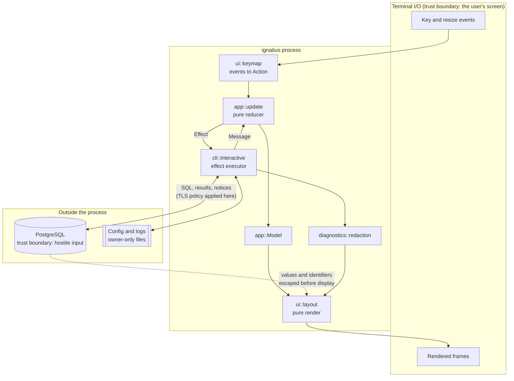

# Implementation Plan: Foundation and proven vertical slice

**Branch**: `001-foundation-vertical-slice` | **Date**: 2026-08-15 | **Spec**: [spec.md](./spec.md)

## Summary

Build the smallest thing that is genuinely trustworthy: one binary that opens a
full-screen PostgreSQL client, runs a query, explains a failure, cancels a long
statement, and gives the terminal back. The same binary is a scriptable CLI with
documented exit codes.

The architecture established here is the point. Every later feature plugs into
it, so the reducer, the ports, the diagnostic shape and the terminal lifecycle
have to be right now rather than later.

## Technical Context

**Language/Version**: Rust, stable, edition 2024. Local toolchain rustc 1.97.1.

**Primary Dependencies**: ratatui 0.30.2 with crossterm 0.29.0, tokio 1.53,
tokio-postgres 0.7.18, rustls 0.23 with rustls-platform-verifier 0.7, clap 4.6,
serde with toml 1.1, secrecy 0.10, thiserror 2, tracing 0.1, directories 6,
unicode-width 0.2.

**Storage**: TOML configuration in XDG-style locations. No database of our own.

**Testing**: `cargo test` for unit, reducer and layout tests; `tests/` for the
CLI contract and PostgreSQL integration; `docker/compose.yaml` for a disposable
server with synthetic data.

**Target Platform**: macOS (Warp), Windows 11 (Windows Terminal), Linux.

**Project Type**: Single Rust package, library plus thin binary.

**Performance Goals**: Interface draws before the connection completes; input and
rendering never wait on the database; result memory bounded by an explicit cap.

**Constraints**: No network call other than the database connection. No secret in
any output. No implicit migration, retry, or TLS downgrade.

## Constitution Check

| Principle | How this plan satisfies it |
| --- | --- |
| I Truthful delight | TLS state read from `pg_stat_ssl`; `Cancellation requested` is a distinct state; connection loss reports unknown outcome |
| II PostgreSQL first | Simple query protocol preserves server text rendering; SQLSTATE and every server error field surfaced |
| III Local-first | No network call but the connection; nothing persisted; logging off by default |
| IV Safe by default | Unsupported security parameters refused; no replay or retry; remote defaults to verify-full |
| V Keyboard-first | Every action bound and listed in help; mouse off by default |
| VI Styling loss | Bracketed word markers; contrast-tested palettes; ASCII mode; text labels for every state |
| VII Cross-platform | One terminal abstraction; platform differences isolated in `src/platform`; CI matrix |
| VIII One source of truth | Branding, exit codes, config schema and release identity each have exactly one home |
| IX Evidence | Container-backed protocol tests; pty-level terminal evidence; traceability table below |
| X Recoverability | RAII guard plus panic hook; atomic writes; backup before migration |

No principle required an exception. The `Complexity Tracking` section is empty.

## Project Structure

```text
src/
  main.rs               Thin process entry point
  lib.rs                Module map
  branding.rs           The only place the product name lives
  exit_code.rs          The exit-code contract
  app/                  Model, messages, pure reducer, effects
  cli/                  Command tree, output formats, interactive runtime
  config/               Paths, schema, validation, atomic writes, migration
  connection/           Target resolution, precedence, TLS policy, classification
  postgres/             Driver adapter, session, cancellation, error mapping
  query/                Statement boundaries, result model, value rendering
  ui/                   Terminal lifecycle, theme tokens, layout, keymap
  diagnostics/          Redaction, layered diagnostics, logging, doctor
  platform/             macOS, Windows and Linux differences
tests/
  cli_contract.rs       Exit codes and stream contracts, as a subprocess
  postgres_integration.rs   Protocol claims against a real server
docker/                 Disposable server and synthetic fixtures
```

**Structure Decision**: One package. There is no second consumer of the library
and no compile-time reason to split, so a workspace would add ceremony without
a boundary. Module boundaries are enforced by review and by the module docs: `ui`
never opens a connection, `app` never performs I/O, and only `postgres` knows the
driver exists.

## Architecture



Rules the diagram encodes: messages only ever flow one way into the reducer;
effects are requests, not work; everything crossing the boundary from PostgreSQL
is treated as hostile and escaped before it reaches the screen; and everything
crossing into a log, a diagnostic or the screen passes through redaction.

## Key design decisions

Recorded as ADRs in `docs/architecture/decisions/`: Rust (0001), Ratatui with
Crossterm (0002), tokio-postgres with the simple query protocol (0003), rustls
with the platform trust store and `verify-ca` refused (0004), a hand-written
statement lexer (0005), TOML in XDG-style locations with SQLite deferred (0006),
secrets in dedicated types with the keyring deferred (0007), and a hand-rolled
release workflow with cargo-dist deferred (0008).

## Requirement-to-test traceability

| Requirement | Evidence |
| --- | --- |
| FR-001 | `cli_contract::help_and_version_succeed_and_go_to_stdout`, `the_interactive_client_refuses_to_start_without_a_terminal` |
| FR-002 | `connection::target::tests::arguments_beat_connection_string_which_beats_environment` |
| FR-003 | `connection::target::tests::uri_parsing_handles_userinfo_ipv6_sockets_and_escapes`, `keyword_value_parsing_handles_quotes_and_escapes` |
| FR-004 | `query::statements::tests::*` (11 tests), `app::update::tests::running_the_statement_at_the_cursor_sends_only_that_statement` |
| FR-005 | `postgres_integration::multiple_statements_produce_multiple_results_in_order`, `server_notices_reach_the_client` |
| FR-006 | `postgres_integration::a_long_statement_can_be_cancelled_and_the_server_confirms_it` |
| FR-007 | `cli::tests::commands_parse_the_way_the_documentation_says` |
| FR-008 | `cli::output::tests::*` (12 tests), `ndjson_writes_one_object_per_line_and_refuses_multiple_result_sets` |
| FR-009 | `config::store::tests::migration_is_idempotent_and_backs_up_before_changing_anything` |
| UX-001 | `ui::layout::tests::the_full_layout_shows_connection_environment_tls_and_hints` |
| UX-002 | `ui::layout::tests::an_error_shows_headline_cause_and_next_action_before_technical_detail` |
| UX-003 | `app::update::tests::cancelling_requests_but_does_not_claim_cancellation`, `query::result::tests::status_wording_never_claims_more_than_is_known` |
| UX-004 | `ui::layout::tests::a_production_connection_is_unmistakable_without_colour`, `every_theme_and_colour_mode_renders_the_same_meaning` |
| UX-005 | `cli::interactive::tests::the_starter_buffer_is_useful_and_names_the_run_key`, `ui::layout::tests::an_empty_state_says_what_to_do_next` |
| UX-006 | `query::value::tests::null_is_distinguishable_from_empty_string_and_from_the_text_null`, `postgres_integration::null_is_distinguishable_from_an_empty_string_over_the_wire` |
| SEC-001 | `diagnostics::redaction::tests::*` (10 tests), `cli_contract::secrets_never_appear_in_output_even_when_the_connection_fails`, `postgres_integration::a_wrong_password_is_reported_as_authentication_not_as_a_generic_failure` |
| SEC-002 | `postgres_integration::requiring_tls_against_a_server_without_it_fails_rather_than_downgrading`, `postgres::error::tests::tls_advice_never_suggests_connecting_without_tls_when_it_was_required` |
| SEC-003 | `postgres_integration::the_session_reports_what_the_server_says_about_itself`, `postgres::tls::tests::an_unconfirmable_tls_state_is_reported_as_unknown_not_as_encrypted` |
| SEC-004 | `connection::target::tests::security_parameters_fail_and_other_unknowns_only_warn`, `cli_contract::a_security_relevant_parameter_is_refused_rather_than_ignored` |
| SEC-005 | `query::value::tests::escape_sequences_from_the_database_cannot_reach_the_terminal`, `ui::layout::tests::hostile_values_cannot_emit_escape_sequences_into_the_interface`, `postgres_integration::hostile_values_from_the_database_cannot_drive_the_terminal` |
| SEC-006 | `connection::target::tests::environment_classification_is_explicit_never_guessed` |
| REL-001 | `ui::terminal::tests::every_mode_that_is_enabled_is_disabled_again`, `restore_order_is_the_reverse_of_acquisition`; pty evidence in `docs/operations/verification.md` |
| REL-002 | `query::result::tests::a_result_set_stops_at_its_cap_but_keeps_counting`, `postgres_integration::results_are_bounded_by_the_row_cap_and_report_the_true_count` |
| REL-003 | `app::update::tests::a_stale_result_cannot_overwrite_a_newer_query` |
| REL-004 | `config::store::tests::save_is_atomic_and_leaves_no_temporary_file` |
| PERF-001 | Connection runs as an effect; first frame drawn before it completes. Pty evidence in `docs/operations/verification.md` |
| PERF-002 | Input thread and async executor are separate from rendering; see `cli::interactive` |
| OPS-001 | `diagnostics::doctor::tests::every_non_ok_check_states_a_next_action`, `cli_contract::doctor_json_is_valid_json_and_carries_the_same_checks` |
| OPS-002 | `cli_contract::version_verbose_separates_product_source_and_build_identity` |
| OPS-003 | `diagnostics::logging::tests::statement_descriptor_never_contains_the_sql`, `logging_is_disabled_when_the_variable_is_absent_or_empty` |
| COMPAT-001 | `exit_code::tests::numeric_values_are_the_documented_contract`, plus real invocations in `cli_contract` for 0, 2, 3, 4, 7 |
| COMPAT-002 | `ui::terminal::tests::no_color_and_dumb_terminals_win_over_configuration`, `cli_contract::piped_output_carries_no_colour_and_no_control_sequences` |
| COMPAT-003 | `connection::target::tests::service_and_password_files_are_reported_as_unread_rather_than_ignored` |

Exit codes 5, 6, 8 and 9 are produced by library-level tests but not yet by a
subprocess invocation; 9 has no producer at all until export lands in Feature
004. This gap is recorded in `docs/status.md` rather than papered over.

## Complexity Tracking

None. No principle needed an exception for this feature.

## W10-007 bounded resource experiment - 2026-10-25

This is measurement authority, not a new product limit. The read-only source
audit at `24db9c5` found post-driver cell/notice-message caps, response
backpressure, no aggregate retained-byte cap and an unbounded session notice
vector. The 200k/2M export evidence measures fixed-width retained growth only.

Use one clean independent clone of exact `24db9c5`, an optimized binary with
actual source/build identity, its own external-SSD target and isolated
configuration/data/passfile routes. Preserve the W07 clone/patch evidence and
root's source/build target. Use only the existing loopback PostgreSQL 18.6
synthetic fixture; no schema/data/configuration changes or lifecycle actions.
Read authenticated server version and `orders` count before/after. Inject only
its synthetic credential through child environment, never arguments or logs.

Measure three independent child invocations per case, with no captured result
values except deliberate synthetic stream files. Record actual per-child peak
RSS (including the platform's units), wall time, exit code and output counts.
Use fresh per-probe measurement helpers or an equivalent method that does not
mistake cumulative child high-water marks for individual results. Record the
host/toolchain, release binary/lock/source digests and concurrent-load limits.

| Case | Bounded synthetic workload |
| --- | --- |
| Baseline | One small SELECT row |
| One oversized retained value | One 2 MiB value, then one 8 MiB value, with a one-row retained cap |
| Oversized value after retention cap | One small row followed by one 8 MiB value, retaining only the first row |
| One oversized notice | One 2 MiB NOTICE, then one small SELECT row |
| Notice-count growth | 256, 4,096 and 16,384 NOTICE messages, each carrying 256 synthetic characters, followed by one small row |
| Complete streaming output | One 8 MiB value through the real CLI file-export route; verify complete bytes/count and remove only that owned disposable payload after recording its digest |

Operational experiment bounds: one probe at a time; 30 seconds per probe with
owned-child termination/reaping on expiry; at most 256 MiB of task output files;
stop later cases if a completed child exceeds 512 MiB peak RSS or any fixture
health/count check changes. These are experiment stop thresholds, not enforced
process-memory ceilings or product promises. The bounded SQL has no persistent
write. Retain safe small logs/metadata, and no delayed numeric-PID watchdog.
Do not add an artificial slow-sink result if the real supported seam is absent.

Report observed medians/ranges for three samples, not a statistically supported
p95. Time/RSS observations are local macOS evidence at this frozen source;
native Windows/Linux, TLS overhead, full UI retention, hostile-frame limits and
the final source candidate need their own evidence. W10-008 pins follow-on
operational contracts after this baseline rather than relabelling these
measurements as complete resource bounds.

## W10-009 buffered truncation disclosure - 2026-10-25

W10-007's two-row query with `--max-rows 1 --format csv --no-header` returned
one row, exit zero and no stderr. `ResultSet::rows_seen` correctly counted two;
CSV discarded that metadata. This contradicts REL-002/constitutional truthful
truncation and the current `--max-rows` help, despite valid row-cap enforcement.

After successful buffered data writing in `cli::query_command`, emit one
value-free stderr line per truncated result set for CSV, TSV, NDJSON, Markdown
and INSERT. Pin wording:

`Result set 1 truncated: retained 1 of 2 received rows. For a future complete streaming export, choose --output before execution.`

Numbers are the one-based result-set ordinal (excluding statements with no
result set), retained row length and server-delivered `rows_seen`. This does not
claim the total rows of a failed query. Include all truncated sets, including
a successful prefix before a later error; preserve that error's existing exit
and diagnostic. Table and JSON already carry in-band retention metadata and
receive no duplicate sideband warning. Non-truncated runs emit no new warning.
Broken-pipe behavior remains the existing intentional-success path. Failure to
write the required stderr status follows the existing I/O diagnostic boundary.

Keep stdout byte-for-byte compatible, including JSON/NDJSON schemas, NULL and
insert escaping. Query success remains exit zero: the server execution was
successful and the status explicitly reports client retention. Do not cancel,
retry or silently rerun a query, especially a write with RETURNING. The wording
refers to a future export choice, never an instruction to replay the completed
statement. The `--output` route still streams every row independently of the
buffered cap. Its help must say it avoids retaining the entire result while
individual values/rows and driver frames still use memory; remove the current
false claim that result size cannot matter.

Write failing-first actual CLI checks against the existing synthetic fixture
for every affected format, multiple sets, a successful prefix then error,
no truncation, zero-row cap and complete file streaming. Use isolated state and
environment-only synthetic credentials, no schema/data/lifecycle changes.
Unit-test only the semantic helper cases needed for ordinals and stderr-write
failure. No new dependency, flag, config key, exit code or result schema.
Core paths: `src/cli/mod.rs`, its `tests.rs` sidecar and `tests/cli_contract.rs`.

## W10-011 real-writer pacing experiment - 2026-10-25

Measurement authority only. Use an independent clean clone of exact
`d8a3ac34ea5a69fb957b04f94c5c90ffa27a1cef`, its own external-SSD target and
Cargo cache, and isolated configuration/data/absent-passfile routes. Preserve
all earlier evidence and root's source/build target. Use only the existing
loopback PostgreSQL 18.6 synthetic fixture without lifecycle/schema/data
changes. Read authenticated version and `orders` count before/after each probe;
inject the synthetic credential through child environment, never logs/arguments.

Build the optimized production library and identity binary with the existing
lockfile and no new dependency or manifest change. Select actual non-test rlibs
from Cargo JSON artifacts; record source, helper, binary, rlib, lockfile,
toolchain and platform identities. An external helper uses Session streaming
and the real `Export::writer()` wrapped by a small synchronous `PacedWrite`,
then normal flush/sync/rename. Do not first buffer through `execute`. This is
the public library path, not the top-level CLI `--output` function.

Run three independent fresh child samples of each of these four cases:

| Data | Unpaced control | Paced case |
| --- | --- | --- |
| Small rows | 8,192 CSV/no-header records from `SELECT repeat('x', 1023) AS value FROM generate_series(1, 8192)` | Identical SQL and encoding, 1 MiB/s accepted-byte pacing |
| Large value | One CSV/no-header record from `SELECT repeat('x', 8 * 1024 * 1024) AS value` | Identical SQL and encoding, 1 MiB/s accepted-byte pacing |

Pacing state persists across every write/event for the complete export. Use
monotonic scheduling with zero initial credit and at most 8 KiB delegated per
write; account actual accepted bytes and handle short/Interrupted writes
correctly. Keep instrumentation constant-size, with no per-write log/queue.
Record first/last accepted-write times, maximum call stall, actual accepted
bytes, complete accepted rows, final closed-file bytes/digest, outcome, wall
time and fresh-child peak RSS. Count a row only after complete encoder success,
following W10-010. Expected files are exactly 8,388,608 and 8,388,609 bytes;
compare complete synthetic bytes/digests with controls, not only lengths.

One probe at a time, 30-second owned-child deadline/reap, at most 256 MiB task
output, stop subsequent probes above 512 MiB completed-child peak RSS or any
fixture version/count change. These are experiment stop thresholds, not enforced
RAM ceilings. Use fresh per-probe measurement helpers and Darwin byte units;
report medians/ranges for three samples, not p95. Inspect helpers before running.
Retain safe metadata/logs and remove only explicitly owned synthetic payloads
after checking them. Do not touch other clones, containers or cached evidence.

This applies consumer backpressure above the real BufWriter, which can flush
in bursts; it is not disk-bandwidth or whole-process memory proof. The large
row retains its own allocations while paced. No cancellation injection is part
of this experiment: a synchronous sink can block the top-level CLI select's
signal polling, so do not imply responsive Ctrl+C, server-confirmed cancellation,
native hand use, TLS, hostile-frame or cross-platform acceptance. No product
flag, output/schema/SQL/transaction change, retry or automatic rollback is
introduced. W10-008 remains open for distinct resource contracts.


## W07-063 uncaught panic library-process observation - 2026-10-25

Freeze application inputs from clean `74eb155` (equal to `d8a3ac3`) and use
the actual Cargo JSON-selected non-test rlib and source/helper/toolchain digests.
Record any root-owned planning-only diff at build time rather than claiming
a clean build identity. Compile a standalone Rust main that acquires the real TerminalGuard,
installs the production panic hook over an observing previous hook that delegates
to the default hook, and panics without catch_unwind. No application panic flag,
new dependency, unsafe FFI, database connection or real profile is introduced.

Run one child per eight mouse/paste/alternate-screen combinations, each in an
owned synthetic PTY with canonical state established/read beforehand, cleared
inherited environment, private config/data and an absent passfile. Record raw
state during acquisition, raw/canonical/echo/signal flags before previous-hook
details, process exit and post-exit terminal flags. Require ordinary panic exit,
restoration sequences matching acquired options in reverse order before the
previous/default hook output, original fixed synthetic panic payload and actual
post-exit flag recovery. Do not count a libtest-caught panic as this observation.

Inspect the helper/driver before execution. Keep a five-second per-child owned
deadline/kill/reap and a one-MiB transcript cap; never signal an unowned PID or
leave a detached watcher. Retain only safe small synthetic transcripts/metadata.
A Darwin PENDIN-only change must be recorded and resolved only by the existing
normal same-PTY input recovery method if needed, not hidden by stty reset.
This proves the library guard/hook process path, not an injected production-app
crash, panic=abort, forced restore failure, native screenshot/hand use or Windows.


## W10-012 bounded notice admission and visible accounting - 2026-10-25

Implement foundation REL-005 through the pinned
[notice retention contract](contracts/notice-retention.md). A single isolated
owner covers the producer, lifecycle, report-carrying APIs and all first-party
consumers; the primary owns policy/shared records and final integration. Keep
256-entry/1-MiB cumulative allowances, 64-KiB message shortening, sticky
privacy before parameterized entry, fixed precision-safe checkpoints and
unchanged PostgreSQL facts. A limit never sends SQL or resets on statement drain.

The TUI holds fixed pending client counts and exposes an explicit read-only
reader. Opening it does not acknowledge; Activate acknowledges only its captured
snapshot, Escape preserves pending state. Protected reviews retain their current
40x8 geometry. Existing public payload-only APIs stay available while first-party
paths carry reports on success, error and export finish failure. JSON diagnostics
remain one object; stdout data schemas/bytes remain unchanged. The contract pins
exact surfaces, source/generation rejection, guard Drop and live-test bounds.

This closes one measured retention route. W10-008 remains open for aggregate
retained data and earlier driver/startup allocation; W10-011 is measurement,
not cancellation or process-memory proof. No new dependency, SQL replay,
automatic rollback, credential path or external action is introduced.


## W10-013 execution-wide retained-result data - 2026-10-25

After W10-012 integration, implement REL-002's pinned
[retained-data contract](contracts/retained-result-data.md). Use one checked
32-MiB logical occupied-data allowance across all buffered result sets, counting
native container/cell slots and retained UTF-8 fields before copying. Preserve
existing row caps and oversized-cell refusal precedence. Whole-row admission
latches a retained prefix; consume/count remaining explicit SQL normally.
Essential-description refusal becomes typed data-unavailable with fixed counts,
not an invented empty result or failed write. Known data bytes/schemas remain
unchanged; Feature 021 FR-2110 explicitly admits the new unavailable-description
JSON flag/source-column count and value-free sideband for other data formats.

No new dependency/flag/configuration or server action is needed. Keep the
existing NoticeReport, operation guards and stream/export contracts; root
serializes shared seams. Test pure small budgets first, then bounded synthetic
live outcomes, action refusals and actual rendered states, followed by the
required combined gate and affected server evidence. Do not claim complete
resource acceptance: driver frames/startup, output/display copies, metadata
caches, control vectors and whole-process RSS remain separate boundaries.


W10-013 source was integrated on 25 October 2026 after frozen native peer and
12 plain/verified-TLS live cases with 24 before/after CLI health children. A
UI-only inner-pane warning repair followed; `docs/operations/verification.md`
separates measured02 source from final03. Both new CI transport routes passed
the missing-wiring regression and pinned Actionlint. The canonical full gate
passed 1,431 outer cases/1,127 library across 24 summaries with the explicit
macOS socket skip. Root captured 112 styled buffers and inspected 16 frame images; affected-major/hosted
acceptance remains open. See verification for exact source/build boundaries.
